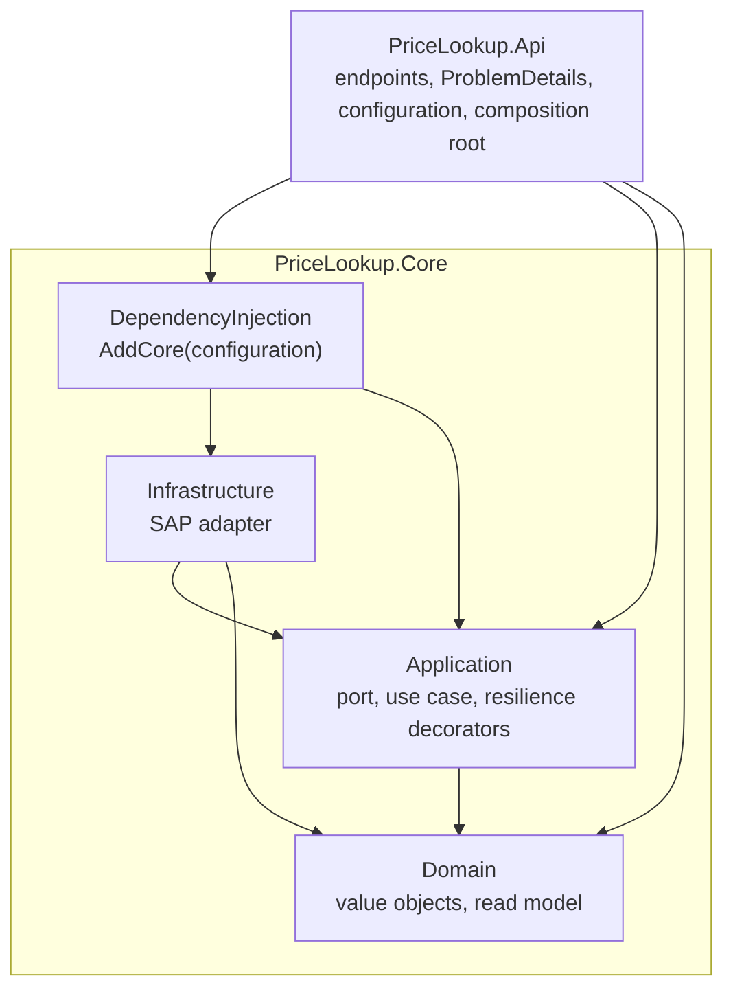

# Implementation plan

Step-by-step plan for building the Price Lookup Service with coding agents (Claude Code), one reviewed commit per step.

Read first: [AGENTS.md](../../AGENTS.md), [requirements.md](../requirements.md), [assumptions.md](../assumptions.md), and [architecture.md](../architecture.md) once it exists (step 1).
The decisions below are final for this plan. Agents implement them; they do not re-decide them. If something does not work as planned, stop and ask.

## Progress tracker

| Step | Title | Estimate | Status | Commit |
|---|---|---|---|---|
| 0 | Planning docs and AGENTS.md (author commits manually) | - | DONE | e827a2e |
| 1 | Architecture document with Mermaid diagrams | 40 min | DONE | d27c4f8 |
| 2 | Solution skeleton, health, ProblemDetails baseline | 40 min | DONE | 62bde31 |
| 3 | Domain: `Sku`, `CurrencyCode`, `Price`, `ProductPrice` | 30 min | DONE | 2200148 |
| 4 | Application: ERP port, use case, results, layering test | 45 min | DONE | 926e63a |
| 5 | Price endpoint with ProblemDetails mapping | 50 min | DONE | d54ab63 |
| 6 | Resilience: attempt timeout, N retries and the total timeout | 75 min | DONE | f787ee6 |
| 7 | SAP adapter: OData V2 client behind the port | 75 min | TODO | |
| 8 | SAP stub app with magic SKUs and end-to-end tests | 60 min | TODO | |
| 9 | X.509 certificate, TLS, options validation, Key Vault | 60 min | TODO | |
| 10 | `docs/frontend-bff.md` (Next.js, written only) | 45 min | TODO | |
| 11 | README and docs alignment | 30 min | TODO | |
| 12 | Optional: CI (GitHub Actions build and test) | 20 min | TODO | |
| 13 | Optional: Azure deployment notes | 45 min | TODO | |
| 14 | Pull request to `main` | 10 min | TODO | |

Status values: `AUTHOR` (the author's own step, agents never take it), `TODO`, `DONE`. When a step is approved the agent sets `DONE` and writes the short hash of the step commit into the Commit column.
Estimates exclude review time. Steps 1 to 11 and 14 are about 9 hours; 12 and 13 only if there is time.
After step 5 the minimum of the assessment is met (endpoint, ERP client interface, fake, found / unknown / failure tests). The rest makes it realistic.

## How to run a step (prompts for Claude Code)

Start every step in a fresh Claude Code session (or after `/clear`) in the repository root.

### 1. Run the next step (copy and paste as is)

```text
Read AGENTS.md and docs/ImplementationPlan/plan.md, plus the docs the step links to.
Take the first step in the progress tracker whose status is TODO. Skip steps whose
title starts with "Optional" unless I name one. Execute that step only: follow its
checklist, run its verification commands and make sure its Definition of Done is met.
Stay inside the step's scope.

Do NOT commit. When the work is done, stop and tell me it is ready for review:
1. What changed and why.
2. Files touched.
3. Verification results: build, tests (passed/failed counts), manual checks
   with the actual commands and their output.
4. Deviations from the plan, doc updates you made, open questions.
Then wait.

If I leave review comments, apply them and report again in the same format.
Repeat until I reply "Approved".

After my "Approved":
1. Commit the step with the step's suggested commit message.
2. Set the step to "DONE" in the progress tracker with that commit's short hash
   and commit it as "docs: mark step N done in progress tracker".
Do not push unless the step says so. Do not start the next step.

If anything is ambiguous, or the plan and the code disagree, stop and ask.
```

### 2. Run a specific step

Use the same prompt and replace the second and third sentences with:

```text
Execute Step 6 only (use the step number you need): follow its checklist, ...
```

### 3. Your replies during review

- Comments: write them in plain words; the agent applies them and reports again.
- Approval: reply with the single word `Approved`.

### 4. Resume a step that was interrupted

```text
Read AGENTS.md and docs/ImplementationPlan/plan.md.
Step N was started in a previous session and is not committed yet. Run git status
and git diff, compare the working tree with the step's checklist, finish whatever
is missing, run the verification commands and report in the usual format.
Do not commit until I reply "Approved".
```

## Decisions at a glance

| Topic | Decision | Reference |
|---|---|---|
| Stack | .NET 10, Minimal API | A30 |
| Projects | `PriceLookup.Core` (Domain, Application, Infrastructure) and `PriceLookup.Api` | A25 to A27 |
| Style | DDD-style, small classes, small methods | A28, A29 |
| Endpoint | `GET /products/{sku}/price` returns `{ sku, price, currency, lastUpdated }` | R1 to R4 |
| SKU | trim, upper-case, `^[A-Z0-9][A-Z0-9._-]{0,39}$` | A11 |
| Errors | `ProblemDetails` + `code` + `traceId`; 400, 404, 502, 504 | A16, A20 |
| ERP port | `IErpClient.GetPriceAsync(Sku, ct)` returns `ProductPrice?` (`null` = not found), throws `ErpException` | step 4 |
| Retries | `RetryingErpClient`: `Erp:RetryCount` = 3 retries (4 attempts), `Erp:RetryDelayMs` = 200, constant | A13, A14 |
| Attempt timeout | `AttemptTimeoutErpClient`: `Erp:AttemptTimeoutMs` = 3000; a timed-out attempt is retryable | A15 |
| Total timeout | `TimeoutErpClient`: `Erp:TotalTimeoutMs` = 7000, wins over everything | A12, A15 |
| Chain | `TimeoutErpClient(RetryingErpClient(AttemptTimeoutErpClient(SapErpClient)))` | A17 |
| SAP | OData V2 over HTTPS (TLS 1.2+), X.509 client certificate only | A6 to A9 |
| Cache | none | A19 |
| Secrets | Key Vault via `AddAzureKeyVault` + managed identity, base64 PFX | A21 to A23 |
| Stub | `tests/PriceLookup.SapStub`, magic SKUs, never deployed | A34, A35 |
| Tests | one project `tests/PriceLookup.Tests`, xUnit v3, `Assert`, no mocking library | A36 |
| Frontend | Next.js App Router, Route Handler BFF, Server Action alternative, written only | A38 |

## Layer rules



- Arrows mean "may reference". Everything else is forbidden (for example Domain must not reference Application, Core must not reference Api, Api must not reference Infrastructure).
- `PriceLookup.Api` reaches the SAP adapter only through `AddCore`, which composes it.
- `LayeringTests` (step 4) enforces this with `NetArchTest.Rules`.

## Lesson from the MVP branch: no god class

In `2026-10-19-mvp` one class, `PriceService` (about 100 lines), did everything: cache lookup and store, a retry loop, two nested cancellation sources (total and per attempt), five `catch` blocks, 502 / 504 decisions, the pause between attempts, and logging. That is the shape this rewrite must not have. The same responsibilities now live in separate small classes:

| Responsibility | MVP | Now |
|---|---|---|
| Validate and normalise the SKU | `Sku` + inline checks | `Sku.TryParse` (Domain) |
| Orchestrate one lookup | `PriceService` | `GetProductPriceHandler`: parse, call the port, map the outcome. Nothing else |
| Retry N times with a pause | loop inside `PriceService` | `RetryingErpClient` (decorator) |
| Per-attempt timeout | a second, nested `CancellationTokenSource` inside the loop | `AttemptTimeoutErpClient` (decorator) |
| Total timeout | `CancellationTokenSource` around the loop | `TimeoutErpClient` (decorator) |
| Failure kind to business error | `switch` inside the `catch` | `ErpFailureMapper` |
| Business error to HTTP | endpoint | `PriceLookupProblemMapper` (Api) |
| HTTP call, OData parsing, status classification | `SapErpClient` | `SapErpClient` + `SapRequestFactory` + `SapResponseClassifier` + `SapPriceMapper` + `ODataDateParser` |
| Cache | inside `PriceService` | none (A19); if it ever returns, it is one more decorator, `CachingErpClient` |

Rules that follow from it:

- No class named `*Service`, `*Manager` or `*Helper`. A class is named after the one thing it does.
- A cross-cutting policy (retry, timeout, and later cache) is a decorator of `IErpClient`, never code inside the use case.
- A method contains at most one `try`, and at most two `catch` blocks. More than that means the method does several jobs: split it.
- The use case never creates a `CancellationTokenSource`, never calls `Task.Delay` and never loops.

## Target layout

```text
/
├── AGENTS.md
├── CLAUDE.md
├── README.md
├── PriceLookup.slnx
├── Directory.Build.props
├── Directory.Packages.props
├── global.json
├── docs/
│   ├── InitialRequirements/IRCO - Technical Assessment.pdf
│   ├── ImplementationPlan/plan.md
│   ├── requirements.md
│   ├── assumptions.md
│   ├── architecture.md                          (step 1)
│   ├── frontend-bff.md                          (step 10)
│   └── deployment.md                            (step 13, optional)
├── src/
│   ├── PriceLookup.Core/
│   │   ├── Domain/
│   │   │   ├── Sku.cs                           value object, TryParse, normalisation
│   │   │   ├── CurrencyCode.cs                  value object, three letters
│   │   │   ├── Price.cs                         amount >= 0 + currency
│   │   │   └── ProductPrice.cs                  read model: Sku, Price, LastUpdated
│   │   ├── Application/
│   │   │   ├── Ports/
│   │   │   │   ├── IErpClient.cs                the port to the ERP
│   │   │   │   ├── ErpException.cs
│   │   │   │   └── ErpFailureKind.cs            Transient, AttemptTimeout, Unauthorized, InvalidResponse, Timeout
│   │   │   ├── GetProductPrice/
│   │   │   │   ├── GetProductPriceHandler.cs    the use case
│   │   │   │   ├── PriceLookupResult.cs
│   │   │   │   ├── PriceLookupError.cs          enum
│   │   │   │   └── ErpFailureMapper.cs          ErpFailureKind to PriceLookupError
│   │   │   └── Resilience/
│   │   │       ├── ErpResilienceOptions.cs      section "Erp"
│   │   │       ├── AttemptTimeoutErpClient.cs   decorator: timeout of one attempt
│   │   │       ├── RetryingErpClient.cs         decorator: N retries, constant pause
│   │   │       └── TimeoutErpClient.cs          decorator: total timeout
│   │   ├── Infrastructure/
│   │   │   └── Sap/
│   │   │       ├── SapOptions.cs                section "Sap"
│   │   │       ├── SapOptionsValidator.cs       (step 9)
│   │   │       ├── SapErpClient.cs              one HTTP call, no retries
│   │   │       ├── SapRequestFactory.cs         builds the OData request
│   │   │       ├── SapResponseClassifier.cs     HTTP status to outcome
│   │   │       ├── SapHttpHandlerFactory.cs     TLS 1.2+, client certificate
│   │   │       ├── SapServiceCollectionExtensions.cs
│   │   │       ├── OData/
│   │   │       │   ├── ODataV2Envelope.cs
│   │   │       │   ├── SapProductPriceDto.cs
│   │   │       │   ├── ODataDateParser.cs
│   │   │       │   └── SapPriceMapper.cs        DTO to ProductPrice
│   │   │       └── Security/
│   │   │           └── ClientCertificateLoader.cs   (step 9)
│   │   └── DependencyInjection/
│   │       └── CoreServiceCollectionExtensions.cs   AddCore(configuration)
│   └── PriceLookup.Api/
│       ├── Program.cs
│       ├── appsettings.json
│       ├── appsettings.Development.json
│       ├── PriceLookup.Api.http
│       ├── Properties/launchSettings.json
│       ├── Endpoints/
│       │   ├── PriceEndpoints.cs
│       │   ├── PriceResponse.cs
│       │   └── PriceResponseMapper.cs
│       ├── Errors/
│       │   ├── ErrorCodes.cs
│       │   ├── ProblemDetailsSetup.cs
│       │   └── PriceLookupProblemMapper.cs      PriceLookupError to HTTP status, code, title
│       └── Configuration/
│           └── KeyVaultConfigurationExtensions.cs   (step 9)
└── tests/
    ├── PriceLookup.Tests/
    │   ├── Architecture/LayeringTests.cs
    │   ├── Domain/                              SkuTests, CurrencyCodeTests, PriceTests
    │   ├── Application/                         GetProductPriceHandlerTests, AttemptTimeoutErpClientTests, RetryingErpClientTests, TimeoutErpClientTests, ErpResilienceChainTests, ErpResilienceOptionsTests
    │   ├── Infrastructure/Sap/                  SapErpClientTests, SapResponseClassifierTests, SapRequestFactoryTests,
    │   │                                        ODataDateParserTests, SapOptionsValidatorTests, ClientCertificateLoaderTests, SapHttpHandlerFactoryTests
    │   ├── Endpoints/PriceEndpointTests.cs
    │   ├── EndToEnd/StubScenarioTests.cs
    │   ├── Fakes/ScriptedErpClient.cs
    │   ├── Fakes/StubHttpMessageHandler.cs
    │   ├── Infrastructure/ApiFactory.cs
    │   └── HealthAndErrorsTests.cs
    └── PriceLookup.SapStub/
        ├── Program.cs                           wiring only
        ├── SapStubHost.cs                       builds the app (usable from tests)
        ├── Scenarios/                           one small class per magic SKU behaviour
        ├── ODataPayloads.cs                     success and error bodies
        ├── CallLog.cs                           per-SKU call counter
        └── Properties/launchSettings.json
```

## Allowed NuGet packages

| Project | Packages |
|---|---|
| `src/PriceLookup.Core` | `Microsoft.Extensions.Http`, `Microsoft.Extensions.Options.ConfigurationExtensions`, `Microsoft.Extensions.Options.DataAnnotations`, `Microsoft.Extensions.Logging.Abstractions`, `Microsoft.Extensions.Hosting.Abstractions` (only for `IHostEnvironment` in `SapOptionsValidator`) |
| `src/PriceLookup.Api` | `Microsoft.AspNetCore.OpenApi`, `Azure.Extensions.AspNetCore.Configuration.Secrets`, `Azure.Identity` |
| `tests/PriceLookup.Tests` | `Microsoft.NET.Test.Sdk`, `xunit.v3`, `xunit.runner.visualstudio`, `Microsoft.AspNetCore.Mvc.Testing`, `NetArchTest.Rules` (only in `LayeringTests`) |
| `tests/PriceLookup.SapStub` | none |

Latest stable versions compatible with `net10.0`, pinned in `Directory.Packages.props`. Anything else: ask first.

## Definition of Done for every step

In addition to the step's own list:

- `dotnet build PriceLookup.slnx` has 0 warnings and 0 errors; `dotnet test PriceLookup.slnx` is green (run it twice for steps that touch timing).
- `LayeringTests` passes (from step 4 on).
- Code shape rules from AGENTS.md hold: methods up to about 15 lines, classes up to about 120 lines, one public type per file. The report names any exception and why.
- Size check, run it and paste the output into the report; the report also names the three longest methods of the step:
  ```bash
  find src tests -name '*.cs' -not -path '*/obj/*' -not -path '*/bin/*' | xargs wc -l | sort -rn | head -8
  ```
- No em dashes or en dashes anywhere. No secrets. Nothing in `src/` references `tests/`.

---

## Step 0 - Planning docs (author)

Done by the author together with Claude before implementation starts.

- [x] `docs/InitialRequirements/IRCO - Technical Assessment.pdf`
- [x] `docs/requirements.md`, `docs/assumptions.md`
- [x] `docs/ImplementationPlan/plan.md`
- [x] `AGENTS.md`, `CLAUDE.md`

The author reviews the documents (all decisions are recorded in [assumptions.md](../assumptions.md#decided-by-the-author)), commits manually with `docs: add requirements, assumptions, agent instructions and implementation plan`, and sets the tracker row to `DONE`.

---

## Step 1 - Architecture document with Mermaid diagrams

**Goal:** `docs/architecture.md`, the design the next steps implement. No code. Satisfies R12.

**Read:** requirements, assumptions, this plan (decisions, layer rules, target layout).

**Checklist**
- [ ] Summary: five bullets (what, ERP access, resilience, errors, fakes).
- [ ] Diagram "System context" (flowchart): user, React UI, BFF, the service, other internal services, Key Vault, SAP.
- [ ] Diagram "Layers" (flowchart): the layer rules above, with the main types inside each layer.
- [ ] Diagram "Main types" (`classDiagram`): `GetProductPriceHandler`, `IErpClient`, `TimeoutErpClient`, `RetryingErpClient`, `AttemptTimeoutErpClient`, `SapErpClient`, `ProductPrice`, `Sku`, `Price`, `CurrencyCode`, `ErpException`, `PriceLookupResult`. Show the decorator chain.
- [ ] Diagram "Request flow" (`sequenceDiagram`): caller, endpoint, handler, total-timeout decorator, retry decorator, attempt-timeout decorator, SAP client, SAP; include the 400 branch and one retry.
- [ ] Diagram "Retry and timeout rules" (flowchart): attempts = `RetryCount + 1`, constant pause, the attempt timeout (A15) turns a hang into a retryable failure, the total timeout wins, which failures retry (A14), the 502 / 504 rule (A16).
- [ ] Error mapping table and one `ProblemDetails` JSON example (from assumptions A20).
- [ ] Configuration table (`Erp:*`, `Sap:*`, `KeyVault:Uri`) with defaults and where values come from locally, in tests and in Azure.
- [ ] "SAP client details": request URL, status classification, TLS and certificate handling.
- [ ] Diagrams "Local run" (API + stub) and "Deployment" (App Service, Key Vault, SAP; the stub is not deployed).
- [ ] Testing strategy table (level, what, double).
- [ ] "Not included, next steps" list.
- [ ] Every diagram renders. Check each Mermaid block with `npx -y @mermaid-js/mermaid-cli -i <file.mmd> -o <file.svg>` (needs Node 18 or newer). If the command fails, preview the file on GitHub or in the editor; say which in the report.

**Out of scope:** any code, project files.

**Verification:** every Mermaid block renders; type and setting names match this plan and `assumptions.md`; relative links work.

**Commit:** `docs: add architecture with Mermaid diagrams`

---

## Step 2 - Solution skeleton, health, ProblemDetails baseline

**Goal:** an empty but correct solution: builds without warnings, passing tests, `/health` answers, every framework error is already a `ProblemDetails` with a `code`.

**Checklist**
- [ ] `global.json`: pin the installed .NET 10 SDK (`dotnet --list-sdks`), `"rollForward": "latestFeature"`, and `"test": { "runner": "Microsoft.Testing.Platform" }` (required by xunit.v3 4.x on the .NET 10 SDK).
- [ ] `Directory.Build.props`: `net10.0`, `Nullable` enable, `ImplicitUsings` enable, `LangVersion` latest, `TreatWarningsAsErrors` true.
- [ ] `Directory.Packages.props`: `ManagePackageVersionsCentrally` true, versions for the allowed packages used so far.
- [ ] `PriceLookup.slnx` with solution folders `src` and `tests`.
- [ ] `src/PriceLookup.Core` class library (`dotnet new classlib`), no template leftovers (`Class1.cs`). Empty for now.
- [ ] `src/PriceLookup.Api` from `dotnet new web`, references `PriceLookup.Core`. No WeatherForecast or template leftovers.
- [ ] `Properties/launchSettings.json`: a single `http` profile on `http://localhost:5080`, `ASPNETCORE_ENVIRONMENT=Development`, `launchBrowser` false. No https profile.
- [ ] `Errors/ErrorCodes.cs`: string constants for every code in the assumptions A20 table.
- [ ] `Errors/ProblemDetailsSetup.cs`: `AddProblemDetails` customisation: add `code` if missing (`404` = `route_not_found`, `405` = `method_not_allowed`, `500` = `internal_error`, otherwise `http_error`), set `instance` to `"{METHOD} {path}"` if missing, make sure `traceId` is present.
- [ ] `Program.cs` (short): `AddProblemDetails`, `UseExceptionHandler()`, `UseStatusCodePages()`, `AddOpenApi()` + `MapOpenApi()` in Development only, `AddHealthChecks()` + `MapHealthChecks("/health")`. No `UseHttpsRedirection`, no HSTS (A3). End the file with `public partial class Program;` if tests need it.
- [ ] `tests/PriceLookup.Tests` (xUnit v3) referencing `PriceLookup.Api` and `PriceLookup.Core`; `Infrastructure/ApiFactory.cs` wrapping `WebApplicationFactory<Program>` with room for per-test settings (`UseSetting`) and service replacement (`ConfigureTestServices`).
- [ ] `HealthAndErrorsTests`: `GET /health` returns `200`; `GET /nope` returns `404`, `application/problem+json`, `code` = `route_not_found`, `traceId` present; `POST /health` returns `405` with `code` = `method_not_allowed`.
- [ ] `.gitignore` contains `artifacts/` (add it if missing).

**Out of scope:** price logic, configuration sections other than logging, the stub.

**Verification**
```bash
dotnet --list-sdks
dotnet build PriceLookup.slnx            # 0 warnings, 0 errors
dotnet test PriceLookup.slnx             # all green
dotnet run --project src/PriceLookup.Api # background task
curl -s -i http://localhost:5080/health  # 200 Healthy
curl -s -i http://localhost:5080/nope    # 404 problem+json with code route_not_found
taskkill //F //IM PriceLookup.Api.exe    # cleanup on Windows
```

**Definition of Done:** build without warnings; tests pass; both curl checks match; no template leftovers; no https profile.

**Commit:** `chore: scaffold solution, projects and ProblemDetails baseline`

---

## Step 3 - Domain: `Sku`, `CurrencyCode`, `Price`, `ProductPrice`

**Goal:** the ubiquitous language as small immutable types with their invariants. Namespace `PriceLookup.Core.Domain`. No dependencies at all (not even `Microsoft.Extensions.*`).

**Checklist**
- [ ] `Sku` (`sealed record`, private constructor so an invalid value cannot exist): `Value`; `static bool TryParse(string? raw, [NotNullWhen(true)] out Sku? sku)`: trim, `ToUpperInvariant`, `[GeneratedRegex]` `^[A-Z0-9][A-Z0-9._-]{0,39}$` (A11); `ToString()` returns `Value`.
- [ ] `CurrencyCode` (`sealed record`, private constructor): `TryParse(string? raw, [NotNullWhen(true)] out CurrencyCode? code)`: trim, upper-case, exactly three letters `A` to `Z`.
- [ ] `Price` (`sealed record`): `Amount` (`decimal`, not negative) and `CurrencyCode Currency`; creation through `TryCreate(decimal amount, CurrencyCode currency, [NotNullWhen(true)] out Price? price)`.
- [ ] `ProductPrice` (`sealed record ProductPrice(Sku Sku, Price Price, DateTimeOffset LastUpdated)`): the read model returned by the ERP port.
- [ ] Tests in `tests/PriceLookup.Tests/Domain`:
  - `SkuTests`: valid (`ABC-123`, `  abc-123  `, `A`, 40 characters, `A.B_C-1`), invalid (`null`, empty, whitespace, 41 characters, `-ABC`, `AB C`, `AB/C`, `ÄBC`, `ABC'1`); normalisation (`abc-123` equals `ABC-123`).
  - `CurrencyCodeTests`: `eur` becomes `EUR`; invalid: `null`, `EU`, `EURO`, `E1R`, empty.
  - `PriceTests`: zero and positive amounts are valid, a negative amount is not.

**Out of scope:** I/O, parsing of SAP formats, anything outside the Domain folder.

**Verification**
```bash
dotnet build PriceLookup.slnx
dotnet test PriceLookup.slnx    # list the new tests in the report
```

**Definition of Done:** all listed tests pass; the Domain folder references nothing but the BCL.

**Commit:** `feat: add domain value objects and product price`

---

## Step 4 - Application: ERP port, use case, results, layering test

**Goal:** the use case `GetProductPriceHandler` works against the port with a programmable fake. Namespace `PriceLookup.Core.Application`.

**Checklist**
- [ ] `Ports/ErpFailureKind.cs`: enum `Transient`, `AttemptTimeout` (one attempt hit its own timeout), `Unauthorized`, `InvalidResponse`, `Timeout` (the total timeout expired).
- [ ] `Ports/ErpException.cs`: `ErpException(ErpFailureKind kind, string message, Exception? inner = null)` with `Kind` and `IsRetryable` (true for `Transient` and `AttemptTimeout`).
- [ ] `Ports/IErpClient.cs`: `Task<ProductPrice?> GetPriceAsync(Sku sku, CancellationToken cancellationToken)`. XML doc: returns `null` when the SKU does not exist; throws `ErpException` on failure; lets `OperationCanceledException` through; one logical lookup.
- [ ] `GetProductPrice/PriceLookupError.cs`: enum `InvalidSku`, `SkuNotFound`, `ErpUnavailable`, `ErpAuthFailed`, `ErpInvalidResponse`, `ErpTimeout`.
- [ ] `GetProductPrice/PriceLookupResult.cs`: `sealed record` with either a `ProductPrice` or a `PriceLookupError`; static `Found(...)` and `Failed(...)`; `IsSuccess`.
- [ ] `GetProductPrice/ErpFailureMapper.cs`: maps `ErpFailureKind` to `PriceLookupError` (`Transient` to `ErpUnavailable`, `Unauthorized` to `ErpAuthFailed`, `InvalidResponse` to `ErpInvalidResponse`, `AttemptTimeout` and `Timeout` to `ErpTimeout`).
- [ ] `GetProductPrice/GetProductPriceHandler.cs`: `Task<PriceLookupResult> HandleAsync(string? rawSku, CancellationToken cancellationToken)`. Parse with `Sku.TryParse` (invalid gives `InvalidSku` without calling the port); call `IErpClient`; `null` gives `SkuNotFound`; `ErpException` goes through `ErpFailureMapper`; `OperationCanceledException` is not caught. Logs the outcome with the SKU (Information on success and not found, Warning on failures). Split into small private methods.
- [ ] `DependencyInjection/CoreServiceCollectionExtensions.cs`: `AddCore(this IServiceCollection, IConfiguration)` registering `GetProductPriceHandler` (scoped). Do not call it from `Program.cs` yet: nothing registers `IErpClient` before step 7, so Development DI validation would fail at startup and break the existing endpoint tests. Step 5 adds the call together with the `IErpClient` replacement in `ApiFactory`.
- [ ] `tests/.../Fakes/ScriptedErpClient.cs` (thread-safe, no mocking library):
  - `WithPrice(string sku, decimal amount, string currency, DateTimeOffset? lastUpdated = null)`
  - `FailsWith(string sku, ErpFailureKind kind, int times = int.MaxValue)`: the first `times` calls throw, later calls behave normally
  - `HangsFor(string sku, int times = int.MaxValue)`: the first `times` calls wait until the token is cancelled
  - `CallsFor(string sku)` and `TotalCalls`
  - scripted failures and hangs are consumed in the order they were added; an unknown SKU returns `null`
- [ ] `Application/GetProductPriceHandlerTests`: found; lower-case input is normalised in the result; unknown SKU gives `SkuNotFound`; invalid SKU gives `InvalidSku` and `TotalCalls` = 0; each `ErpFailureKind` gives its `PriceLookupError` (theory); a cancelled token throws `OperationCanceledException` and is not mapped.
- [ ] `Architecture/LayeringTests` with `NetArchTest.Rules`: Domain does not depend on Application, Infrastructure or Api; Application does not depend on Infrastructure or Api; Core does not depend on Api; `PriceLookup.Api` does not depend on `PriceLookup.Core.Infrastructure`. If the package does not work on .NET 10, stop and ask.

**Out of scope:** retries, timeouts, HTTP, SAP, the endpoint.

**Verification**
```bash
dotnet build PriceLookup.slnx
dotnet test PriceLookup.slnx
```

**Definition of Done:** Application references only Domain and `Microsoft.Extensions.Logging.Abstractions`; `LayeringTests` is green; the handler has no catch-all `catch (Exception)`.

**Commit:** `feat: add ERP port and get-product-price use case`

---

## Step 5 - Price endpoint with ProblemDetails mapping

**Goal:** `GET /products/{sku}/price` works end to end against `ScriptedErpClient` in tests. Covers R1 to R4 and the "found / unknown / failure" part of R8.

**Checklist**
- [ ] `Endpoints/PriceResponse.cs`: `sealed record PriceResponse(string Sku, decimal Price, string Currency, DateTimeOffset LastUpdated)`, camelCase JSON (default web options).
- [ ] `Endpoints/PriceResponseMapper.cs`: `ProductPrice` to `PriceResponse`.
- [ ] `Errors/PriceLookupProblemMapper.cs`: `PriceLookupError` to a `ProblemHttpResult` with status, `code` (from `ErrorCodes`), `title`, a short human `detail` with the SKU, `instance` and `traceId`. The titles are the ones in the Errors table of [architecture.md](../architecture.md#errors). One table or one `switch` expression; no `if` ladders.
  - `InvalidSku` 400 `invalid_sku`, `SkuNotFound` 404 `sku_not_found`, `ErpUnavailable` 502 `erp_unavailable`, `ErpAuthFailed` 502 `erp_auth_failed`, `ErpInvalidResponse` 502 `erp_invalid_response`, `ErpTimeout` 504 `erp_timeout`.
- [ ] `Endpoints/PriceEndpoints.cs`: `MapPriceEndpoints()` extension; the handler delegates to `GetProductPriceHandler` and returns `Results<Ok<PriceResponse>, ProblemHttpResult>`; the request handler method is a few lines. OpenAPI metadata (`WithName`, `ProducesProblem` for 400, 404, 502, 504).
- [ ] `Program.cs`: `AddCore(builder.Configuration)` and `MapPriceEndpoints()`.
- [ ] `Infrastructure/ApiFactory.cs`: a test passes its own `ScriptedErpClient`; the factory replaces `IErpClient` via `ConfigureTestServices` (`RemoveAll<IErpClient>()` + singleton). One factory per test.
- [ ] `Infrastructure/ApiFactory.cs`: registers a fresh, empty `ScriptedErpClient` by default, so tests that do not pass their own fake (`HealthAndErrorsTests`) keep working once `Program.cs` calls `AddCore`.
- [ ] `Endpoints/PriceEndpointTests`:
  - found SKU: `200`, body has `sku`, `price`, `currency`, `lastUpdated` with the fake's values
  - lower-case input finds the upper-case SKU, response `sku` is normalised
  - unknown SKU: `404`, `code` = `sku_not_found`
  - invalid SKU (for example `AB%20C`): `400`, `code` = `invalid_sku`, `TotalCalls` = 0
  - ERP failure kinds: `Transient` gives `502 erp_unavailable`, `Unauthorized` gives `502 erp_auth_failed`, `InvalidResponse` gives `502 erp_invalid_response`, `Timeout` and `AttemptTimeout` give `504 erp_timeout` (theory)
  - every error response is `application/problem+json` with `code` and `traceId`

**Note:** there is no production `IErpClient` until step 7, so `dotnet run` fails when a price is requested (or at startup validation). That is expected; this step is verified by tests only.

**Out of scope:** retries, timeouts, SAP.

**Verification**
```bash
dotnet build PriceLookup.slnx
dotnet test PriceLookup.slnx    # list the new tests in the report
```

**Definition of Done:** all listed tests pass; error codes come from `ErrorCodes`, no string literals in the endpoint; the Api project contains no reference to Infrastructure types.

**Commit:** `feat: add price endpoint with ProblemDetails error mapping`

---

## Step 6 - Resilience: attempt timeout, N retries and the total timeout

**Goal:** three decorators implement A12 to A18. They wrap any `IErpClient`; they do not know about HTTP or SAP. The chain, outermost first: `TimeoutErpClient(RetryingErpClient(AttemptTimeoutErpClient(inner)))`.

**Checklist**
- [ ] `Resilience/ErpResilienceOptions.cs` (section `Erp`, plain class, no `IOptions` dependency in the decorators): `TotalTimeoutMs` = 7000 (range 1 to 60000), `AttemptTimeoutMs` = 3000 (1 to 60000), `RetryCount` = 3 (0 to 10), `RetryDelayMs` = 200 (0 to 10000), data annotations.
- [ ] `Resilience/AttemptTimeoutErpClient.cs` (`IErpClient` decorator): a linked `CancellationTokenSource` with `CancelAfter(AttemptTimeoutMs)` is passed to the inner client. If only this source fired and the incoming token did not, throw `ErpException(ErpFailureKind.AttemptTimeout)`. If the incoming token fired (the total timeout or the caller), let `OperationCanceledException` through.
- [ ] `Resilience/RetryingErpClient.cs` (`IErpClient` decorator, takes the inner client, `ErpResilienceOptions`, `ILogger`):
  - attempts = `RetryCount + 1`; a retry happens only for `ErpException.IsRetryable` (`Transient` or `AttemptTimeout`), after `Task.Delay(RetryDelayMs, cancellationToken)`
  - when retries are exhausted, rethrow the last exception, so the last attempt decides between 502 and 504 (A16)
  - `null` (not found) and non-retryable `ErpException` are returned / thrown at once
  - `OperationCanceledException` is never caught
  - logs every failed attempt at Warning (attempt number of total, SKU, kind)
- [ ] `Resilience/TimeoutErpClient.cs` (`IErpClient` decorator): a linked `CancellationTokenSource` with `CancelAfter(TotalTimeoutMs)` passed to the inner client; if the linked token fired and the caller's token did not, throw `ErpException(ErpFailureKind.Timeout)`; if the caller's token fired, let `OperationCanceledException` through (A18).
- [ ] `appsettings.json` of the Api: the `Erp` section with the defaults (`TotalTimeoutMs` 7000, `AttemptTimeoutMs` 3000, `RetryCount` 3, `RetryDelayMs` 200).
- [ ] `AddCore`: bind `ErpResilienceOptions` with `ValidateDataAnnotations()`, the cross-field rule `AttemptTimeoutMs <= TotalTimeoutMs` (`Validate(...)` with a clear message) and `ValidateOnStart()`. The decorator chain itself is composed in step 7, when `SapErpClient` exists.
- [ ] Tests with tiny values, using `ScriptedErpClient`:
  - `AttemptTimeoutErpClientTests` (`AttemptTimeoutMs` 100): a hang throws `ErpException` with `AttemptTimeout`, elapsed below 100 + 300 ms; a fast success passes through; not found (`null`) passes through; an incoming token cancelled while hanging throws `OperationCanceledException`, not `AttemptTimeout`
  - `RetryingErpClientTests` (`RetryDelayMs` 10): success on the first call = 1 call; transient twice then success = 3 calls; `AttemptTimeout` once then success = 2 calls; transient always throws `Transient` after `RetryCount + 1` calls (theory with `RetryCount` 0, 1, 3); `AttemptTimeout` always throws `AttemptTimeout` after `RetryCount + 1` calls; `Unauthorized` and `InvalidResponse` = 1 call; not found = `null`, 1 call; the pause is respected (`RetryDelayMs` 100, two failures then success: elapsed at least 200 ms); a caller token cancelled during the pause throws `OperationCanceledException`
  - `TimeoutErpClientTests`: a hang throws `ErpException` with `Timeout`, elapsed below `TotalTimeoutMs` + 300 ms; a fast success passes through; a caller token cancelled while hanging throws `OperationCanceledException`, not `Timeout`
  - full chain `TimeoutErpClient(RetryingErpClient(AttemptTimeoutErpClient(fake)))` with `AttemptTimeoutMs` 100, `TotalTimeoutMs` 600, `RetryDelayMs` 10, `RetryCount` 3: the first call hangs, the second returns a price = found, 2 calls, elapsed at least 100 ms; always hangs = `AttemptTimeout` after exactly 4 calls (retries ran out before the total timeout); with `TotalTimeoutMs` 250 and always hangs = `Timeout`, elapsed below 250 + 300 ms, at least 2 calls; transient always = `Transient` after exactly 4 calls; `RetryDelayMs` larger than `TotalTimeoutMs` with a transient failure = `Timeout` (the budget ends during the pause)
  - `ErpResilienceOptionsTests`: out-of-range values fail validation; `AttemptTimeoutMs` above `TotalTimeoutMs` fails validation
- [ ] Endpoint test: the `Timeout` and `AttemptTimeout` mapping to `504 erp_timeout` is already covered in step 5; do not duplicate it.

**Out of scope:** the SAP client and the composition of the chain (step 7).

**Verification**
```bash
dotnet build PriceLookup.slnx
dotnet test PriceLookup.slnx    # whole suite stays fast, no test above 1 s; run it twice
```

**Definition of Done:** no Polly or resilience packages; each decorator is one small class with a single responsibility; the behaviour matches the flowchart in `docs/architecture.md`.

**Commit:** `feat: add attempt timeout, retry and total timeout decorators for the ERP client`

---

## Step 7 - SAP adapter: OData V2 client behind the port

**Goal:** the production `IErpClient`: `SapErpClient`, wired into the decorator chain. Contract: assumptions A9. No certificate loading yet (step 9).

**Checklist**
- [ ] `Infrastructure/Sap/SapOptions.cs` (section `Sap`): `BaseUrl`, `ServicePath` (default `/sap/opu/odata/sap/ZSD_PRODUCT_PRICE_SRV/`), `SapClient` (default `100`), `ClientCertificateBase64`, `ClientCertificatePassword`.
- [ ] `OData/ODataV2Envelope.cs` (`d` wrapper), `OData/SapProductPriceDto.cs` (`Sku`, `Price`, `Currency`, `LastChangedAt` as strings).
- [ ] `OData/ODataDateParser.cs`: `/Date(ms)/` and `/Date(ms+hhmm)/` to `DateTimeOffset` (UTC, offset ignored); returns failure instead of throwing.
- [ ] `OData/SapPriceMapper.cs`: DTO to `ProductPrice`; invalid price, currency or date throws `ErpException(InvalidResponse)`. The SKU of the result is the requested SKU. `InvariantCulture` everywhere.
- [ ] `SapRequestFactory.cs`: `GET {ServicePath}ProductPriceSet('{Uri.EscapeDataString(sku)}')?sap-client={SapClient}&$format=json`, `Accept: application/json`.
- [ ] `SapResponseClassifier.cs`: `200` parse, `404` not found, `401` / `403` `Unauthorized`, `408` / `429` / `5xx` `Transient`, any other status `InvalidResponse` (A14).
- [ ] `SapErpClient.cs` (`IErpClient`): builds the request, sends it once, classifies the response, maps the body. `HttpRequestException` becomes `Transient`; `JsonException` becomes `InvalidResponse`; `OperationCanceledException` is never caught; never retries; never logs credentials.
- [ ] `SapHttpHandlerFactory.cs`: a `SocketsHttpHandler` with `SslOptions.EnabledSslProtocols = Tls12 | Tls13`; accepts an optional `X509Certificate2` and adds it to `SslOptions.ClientCertificates` when present.
- [ ] `SapServiceCollectionExtensions.AddSapErpClient(IConfiguration)`: binds `SapOptions`; registers `SapErpClient` as a typed client (`BaseAddress` from options, `HttpClient.Timeout = Timeout.InfiniteTimeSpan`, primary handler from `SapHttpHandlerFactory`); registers `IErpClient` as `TimeoutErpClient(RetryingErpClient(AttemptTimeoutErpClient(SapErpClient)))`. Called from `AddCore`.
- [ ] `appsettings.json`: `Sap` section with placeholders (`BaseUrl` `https://sap.example.invalid`, empty certificate settings). `appsettings.Development.json`: `Sap:BaseUrl` = `http://localhost:5199`.
- [ ] `Fakes/StubHttpMessageHandler.cs`: returns a scripted response or throws, records requests.
- [ ] Tests:
  - `SapErpClientTests` (client built with `new HttpClient(stubHandler) { BaseAddress = ... }`): `200` with the A9 payload gives `ProductPrice` (19.99 EUR, `LastUpdated` from the date); `/Date(ms)/` without offset also parses; `404` gives `null`; `401` and `403` give `Unauthorized`; `408`, `429`, `500`, `503` give `Transient`; `400` gives `InvalidResponse`; malformed JSON, missing `d`, unparsable price, currency or date give `InvalidResponse`; `HttpRequestException` gives `Transient`; the request URL contains `ProductPriceSet('ABC-123')`, `sap-client=100`, `$format=json`
  - `SapResponseClassifierTests`, `SapRequestFactoryTests`, `ODataDateParserTests` (valid, with offset, garbage)
  - `SapHttpHandlerFactoryTests`: TLS protocols are exactly 1.2 and 1.3; a certificate passed in is in `ClientCertificates`; without one the list is empty

**Out of scope:** loading the certificate from configuration, options validation, Key Vault (step 9), the stub (step 8).

**Verification**
```bash
dotnet build PriceLookup.slnx
dotnet test PriceLookup.slnx
dotnet run --project src/PriceLookup.Api          # background task, Development, no stub running
curl -s -i http://localhost:5080/products/ABC-123/price
# expected on Windows: 504, code erp_timeout after about 7 s. A refused connection to localhost
# takes about 2 s per address (::1, then 127.0.0.1), so each attempt hits the 3 s attempt timeout;
# attempts 1 and 2 fail with AttemptTimeout, attempt 3 is cut by the total timeout.
# The log shows 2 Warning lines from RetryingErpClient (one per failed attempt)
# plus 1 Warning from GetProductPriceHandler with the final result (Timeout, ErpTimeout).
# expected on Linux, or with an unresolvable host: 502, code erp_unavailable after about 0.6 s
# (4 attempts). The log shows 4 Warning lines from RetryingErpClient (one per failed attempt)
# plus 1 Warning from GetProductPriceHandler with the final result (Transient, ErpUnavailable).
taskkill //F //IM PriceLookup.Api.exe
```

**Definition of Done:** `SapErpClient` makes one call per invocation; the chain is `TimeoutErpClient(RetryingErpClient(AttemptTimeoutErpClient(SapErpClient)))`; the manual check matches.

**Commit:** `feat: add SAP OData V2 client behind the ERP port`

---

## Step 8 - SAP stub app with magic SKUs and end-to-end tests

**Goal:** `tests/PriceLookup.SapStub`, a tiny Minimal API app that imitates the SAP OData endpoint (A9) with the magic SKUs (A35); and end-to-end tests that run the real chain against it. Not referenced from `src/`, never deployed (A34).

**Checklist**
- [ ] `dotnet new web` in `tests/PriceLookup.SapStub`, added to the solution under `tests`; no reference from or to `src/`.
- [ ] `Properties/launchSettings.json`: a single `http` profile on `http://localhost:5199`, Development.
- [ ] `Program.cs` is wiring only (a few lines) and calls `SapStubHost` (builds the `WebApplication`, so tests can host it in-process).
- [ ] Route `GET /sap/opu/odata/sap/ZSD_PRODUCT_PRICE_SRV/{segment}`: parse `ProductPriceSet('<sku>')` from the segment with a regex; anything else gives an SAP-like `400` error body.
- [ ] One small class per scenario in `Scenarios/` (found, flaky, hang-sometimes, always `500`, `401`, malformed JSON, slow, not found) behind one tiny interface; a lookup picks the scenario by SKU. Table: assumptions A35. `FLAKY-1` answers `503` unless the per-SKU call number is a multiple of 3. `SLOW-1` always waits 10 s; `HANG-1` waits 10 s on calls 1, 4, 7, ... (call number % 3 == 1) and answers `200` (2.50 EUR) otherwise; both stop waiting when `RequestAborted` fires. `AUTH-1` sends `WWW-Authenticate`.
- [ ] `ODataPayloads.cs`: the success body and the SAP Gateway `404` body exactly as in A9 (`d`, string price, `/Date(ms+0000)/`).
- [ ] `CallLog.cs`: thread-safe per-SKU call counter registered as a singleton; one log line per request (SKU, returned status).
- [ ] Credentials and client certificates are ignored.
- [ ] `src/PriceLookup.Api/PriceLookup.Api.http`: one request per magic SKU plus an invalid SKU and an unknown SKU.
- [ ] End-to-end tests in `tests/PriceLookup.Tests/EndToEnd/StubScenarioTests.cs`: host the stub in-process (`WebApplicationFactory` over the stub or `SapStubHost`, no fixed ports) and route the API's SAP `HttpClient` to it; the API uses fast settings (`Erp:TotalTimeoutMs` about 600, `Erp:AttemptTimeoutMs` about 150, `Erp:RetryDelayMs` about 10, `Erp:RetryCount` 3). A fresh stub per test class. Cases:
  - `ABC-123` gives `200` (19.99 EUR); `XYZ-999` gives `200` (1250.00 PLN)
  - an unknown valid SKU gives `404 sku_not_found`
  - `FLAKY-1` gives `200` and the stub saw 3 calls
  - `FAIL-1` gives `502 erp_unavailable` and the stub saw exactly 4 calls (1 + N)
  - `AUTH-1` gives `502 erp_auth_failed`, 1 call
  - `BROKEN-1` gives `502 erp_invalid_response`, 1 call
  - `HANG-1` gives `200` and the stub saw 2 calls (the first one cut by the attempt timeout)
  - `SLOW-1` gives `504 erp_timeout` within the small total timeout and the stub saw at least 2 calls
  - an invalid SKU gives `400 invalid_sku` and the stub saw 0 calls
- [ ] Manual check with the real processes (below).

**Verification** (both apps as background tasks)
```bash
dotnet build PriceLookup.slnx
dotnet test PriceLookup.slnx
dotnet run --project tests/PriceLookup.SapStub
dotnet run --project src/PriceLookup.Api
for s in ABC-123 abc-123 XYZ-999 NOPE-1 'bad%20sku' FLAKY-1 FAIL-1 AUTH-1 BROKEN-1 HANG-1 SLOW-1; do
  echo "== $s"; curl -s -w '\nHTTP %{http_code} in %{time_total}s\n' "http://localhost:5080/products/$s/price"; echo
done
taskkill //F //IM PriceLookup.Api.exe; taskkill //F //IM PriceLookup.SapStub.exe
dotnet publish src/PriceLookup.Api -c Release -o artifacts/publish && ls artifacts/publish
```
Expected: `200`, `200`, `200`, `404 sku_not_found`, `400 invalid_sku`, `200`, `502 erp_unavailable` (about 0.6 s plus calls), `502 erp_auth_failed`, `502 erp_invalid_response`, `200` after about 3.2 s (`HANG-1`, on a fresh stub), `504 erp_timeout` after about 7 s. Paste the output into the report.

**Definition of Done**
- Every row of the A35 table behaves as expected, in tests and with the real processes.
- The publish output contains no `SapStub` and no test assemblies.
- The stub's `Program.cs` is wiring only; each scenario class is small.

**Commit:** `feat: add SAP stub app and end-to-end tests`

---

## Step 9 - X.509 certificate, TLS, options validation, Key Vault

**Goal:** the secure and configurable part of the SAP adapter. Assumptions A6 to A8, A21 to A24.

**Checklist**
- [ ] `Infrastructure/Sap/Security/ClientCertificateLoader.cs`: base64 PFX (and optional password) to `X509Certificate2` with `X509CertificateLoader.LoadPkcs12`; requires a private key; clear error messages that never contain secret values.
- [ ] `Infrastructure/Sap/SapOptionsValidator.cs` (`IValidateOptions<SapOptions>`, uses `IHostEnvironment`):
  - `BaseUrl` is absolute; the scheme is `https`, except in `Development` where `http` is also allowed (A8)
  - `ServicePath` is not empty; `SapClient` is three digits
  - outside `Development`: the certificate is required, loads, and has a private key
  - in `Development`: the certificate is optional
- [ ] `AddSapErpClient`: load the certificate once at startup (when configured) and pass it to `SapHttpHandlerFactory`; register the validator with `ValidateOnStart`.
- [ ] `PriceLookup.Api/Configuration/KeyVaultConfigurationExtensions.cs`: when `KeyVault:Uri` is not empty, `AddAzureKeyVault(new Uri(uri), new DefaultAzureCredential())`; skipped when empty (A22). Called in `Program.cs` before the options are read.
- [ ] `appsettings.json`: `KeyVault:Uri` empty; the `Sap` placeholders from step 7 stay.
- [ ] Tests:
  - `ClientCertificateLoaderTests`: a self-signed certificate created in the test (`CertificateRequest`, exported as PKCS#12, base64) loads; garbage base64 fails; a certificate without a private key fails; the error message does not contain the password
  - `SapOptionsValidatorTests`: `http` `BaseUrl` fails in `Production` and passes in `Development`; a missing certificate fails in `Production` and passes in `Development`; a valid self-signed certificate passes in `Production`; bad `SapClient` fails; empty `ServicePath` fails
  - a test that the Key Vault provider is skipped when `KeyVault:Uri` is empty (assert on the configuration sources)
  - `SapHttpHandlerFactoryTests`: `SslOptions.RemoteCertificateValidationCallback` is `null`, so the SAP server certificate is validated with the platform's default rules (A41)
- [ ] Existing end-to-end tests still pass (they run in `Development`).

**Out of scope:** real SAP or Key Vault calls, certificate rotation automation.

**Verification**
```bash
dotnet build PriceLookup.slnx
dotnet test PriceLookup.slnx
ASPNETCORE_ENVIRONMENT=Production dotnet run --project src/PriceLookup.Api --no-launch-profile
# expected: refuses to start, validation error about the client certificate (and the https rule); no secret values in the message
dotnet run --project src/PriceLookup.Api   # Development: starts normally
taskkill //F //IM PriceLookup.Api.exe
```

**Definition of Done**
- Production code has no "no authentication" switch; the only relaxation is the `Development` environment check.
- No secrets in any committed file; no secret in any log or error message.
- Starting in `Production` without a certificate fails with a clear message.

**Commit:** `feat: add X.509 client certificate, TLS settings, options validation and Key Vault`

---

## Step 10 - `docs/frontend-bff.md` (written only)

**Goal:** R9 to R11. A document, no code in the repo. The author has little frontend experience: snippets must be short (each under about 40 lines), commented and easy to explain in an interview. A38.

**Checklist**
- [ ] Overview and a Mermaid sequence diagram: browser, React client component, BFF Route Handler, Price Lookup Service.
- [ ] BFF Route Handler snippet (`app/api/products/[sku]/price/route.ts`, Next.js 15+ conventions, `params` is a Promise): server-only `PRICE_SERVICE_URL`; the same SKU rule as A11 for an early `400`; `fetch` with `AbortSignal.timeout(8000)` (longer than 7 s) and `cache: 'no-store'`; passes through the service's status and `ProblemDetails`; maps network errors to `503 bff_upstream_unavailable` and its own timeout to `504 bff_timeout`; never leaks the internal URL; forwards a correlation header (`traceparent`).
- [ ] Server Action alternative: a short snippet returning `{ ok: true, data } | { ok: false, code, message }`, and when to choose it over the Route Handler.
- [ ] React client component snippet: SKU input, submit, states `idle | loading | success | error`, button disabled while loading, `AbortController` to cancel a previous request, price formatted with `Intl.NumberFormat` and `currency`, `lastUpdated` with `Intl.DateTimeFormat`, `aria-live` for the result.
- [ ] Error mapping table: every `code` from A20 plus the two `bff_*` codes, HTTP status, UI message, whether a "Try again" button is shown (yes for `502`, `503`, `504`; no for `400`, `404`).
- [ ] Notes: no retries in the BFF (the service retries up to 3 times), the BFF is the only public entry point, client-side validation is a UX hint and the service stays the authority.
- [ ] Mermaid diagram validated (same method as step 1).

**Definition of Done:** R9, R10, R11 are each clearly answered; snippets are consistent with the real API (route, field names, codes); links from `architecture.md` and `requirements.md` work.

**Commit:** `docs: describe frontend and BFF integration`

---

## Step 11 - README and docs alignment

**Goal:** a reviewer can understand, run and test the project from the README alone (R13).

**Checklist**
- [ ] `README.md`:
  - one-paragraph summary and a link to the assessment
  - prerequisites (.NET 10 SDK), quick start in bash: stub, API, `curl` examples for the magic SKUs with expected results
  - how to run the tests
  - the API: route, `200` example, `ProblemDetails` example, error code table
  - configuration table and where values come from locally and in Azure
  - key decisions and trade-offs in a few bullets (DDD in two projects, three resilience decorators instead of Polly, attempt timeout plus a total timeout that wins, X.509 only, no cache), with links to `assumptions.md` and `architecture.md`
  - project layout, what is not included / next steps
  - links to all docs, including `docs/frontend-bff.md` and this plan
- [ ] Re-read `docs/architecture.md` and `docs/assumptions.md` against the code; fix any drift (names, defaults, codes).
- [ ] After writing `README.md`, read it back from disk and confirm that the content really landed (it must be the new text, not the old two-line file). If it did not, write it again, up to 3 attempts, and say so in the report.

**Verification**
```bash
dotnet build PriceLookup.slnx && dotnet test PriceLookup.slnx
# follow the README quick start literally and confirm every command works
```

**Definition of Done:** the quick start works exactly as written; no broken relative links; `README.md` on disk is the new version.

**Commit:** `docs: write README and align docs with implementation`

---

## Step 12 - Optional: CI

**Goal:** build and test on every push and pull request.

**Checklist**
- [ ] `.github/workflows/ci.yml`: on `push` and `pull_request`; `ubuntu-latest`; current major versions of `actions/checkout` and `actions/setup-dotnet` (with `global-json-file: global.json`); `dotnet restore`, `dotnet build --no-restore`, `dotnet test --no-build`.
- [ ] CI badge in `README.md` (verify the write, as in step 11).

**Verification:** the workflow runs green on the pushed branch (the author pushes; the agent reports the run result if `gh` is available).

**Commit:** `ci: add GitHub Actions build and test workflow`

---

## Step 13 - Optional: Azure deployment notes

**Goal:** describe how the service gets to Azure App Service with Key Vault (A2, A22, A23). Ask the author before running anything against Azure.

**Checklist**
- [ ] `docs/deployment.md` with bash `az` CLI commands: resource group; Linux App Service plan; web app with the .NET 10 runtime; system-assigned managed identity; Key Vault (RBAC) and the `Key Vault Secrets User` role for the identity; secrets `Sap--BaseUrl`, `Sap--ClientCertificateBase64`, `Sap--ClientCertificatePassword`, `Erp--TotalTimeoutMs`, `Erp--AttemptTimeoutMs`, `Erp--RetryCount`, `Erp--RetryDelayMs`, and the optional overrides `Sap--ServicePath` and `Sap--SapClient` (only when they differ from the defaults); app setting `KeyVault__Uri`; health check path `/health`; `dotnet publish src/PriceLookup.Api` + `az webapp deploy`. Only `src/PriceLookup.Api` is published; the stub is never deployed.
- [ ] Certificate rotation: new secret version, restart.
- [ ] Optional deploy job in the CI workflow (OIDC `azure/login`) only if the author asks for it.

**Commit:** `docs: add Azure deployment notes`

---

## Step 14 - Pull request to `main`

**Goal:** submit (R13).

**Checklist**
- [ ] All previous steps are `DONE` (optional ones may stay `TODO`) in the tracker; `git status` is clean.
- [ ] Draft the PR title and description: summary, how to run, how to test, links to docs, what is optional or not included. Show it in the report and wait for "Approved".
- [ ] After "Approved": mark step 14 `DONE` in the tracker (commit `docs: mark step 14 done in progress tracker`), `git push origin 2026-10-20-new-vision`, then `gh pr create --base main --head 2026-10-20-new-vision` with the approved text. If `gh` is not available, give the author the text to paste in the GitHub UI.

**Commit:** only the tracker update.
