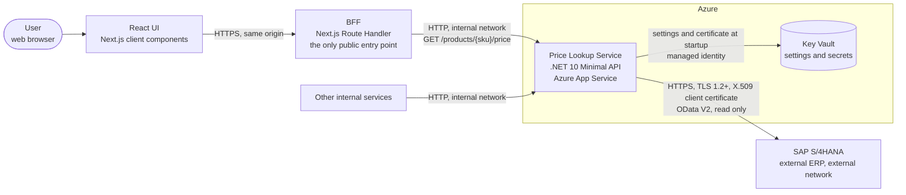
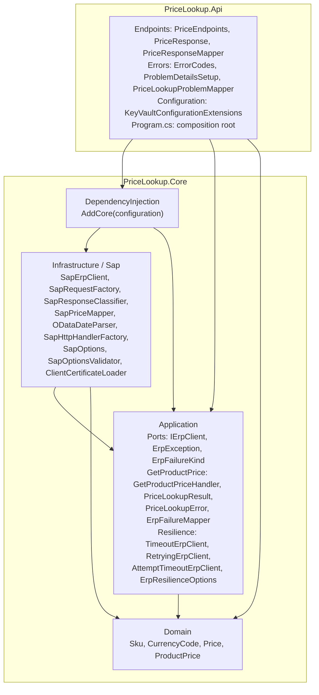
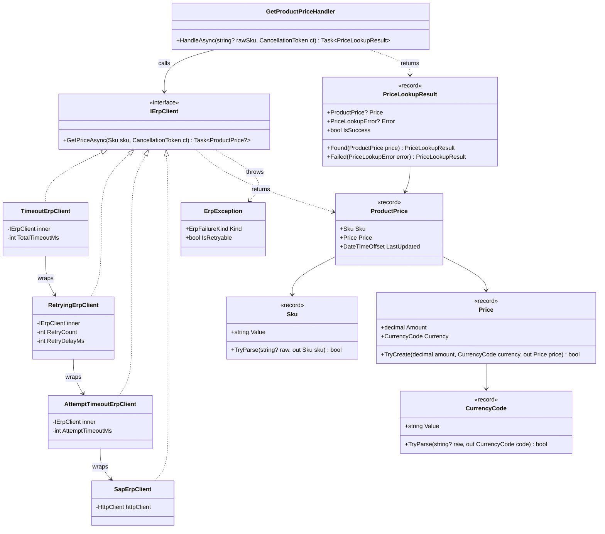
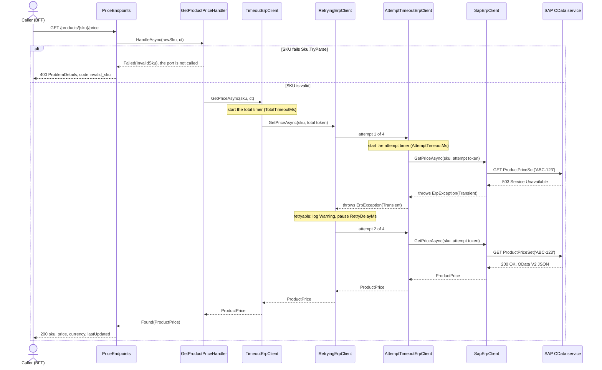
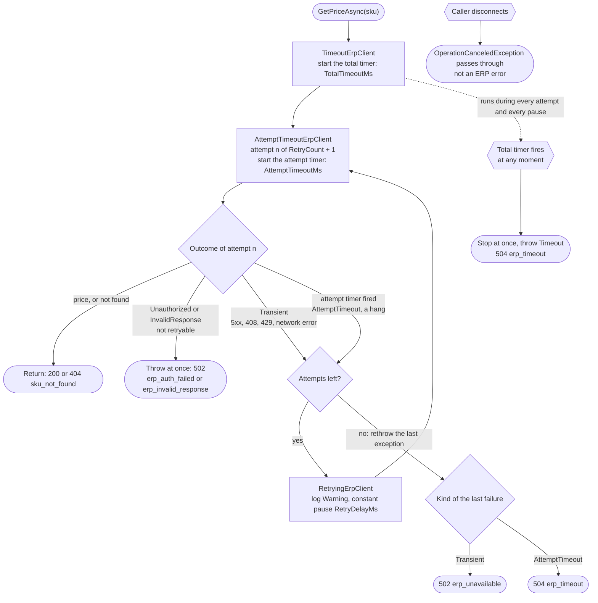
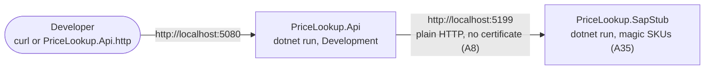
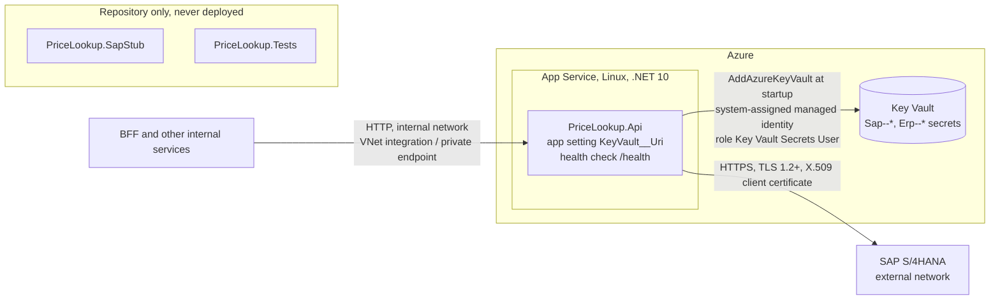

# Architecture

The design of the Price Lookup Service: the components, the flows, the error mapping and the configuration.
It answers R12 of the [requirements](requirements.md). The decisions behind it are recorded in [assumptions.md](assumptions.md) (IDs `A1`, `A2`, ...) and the [implementation plan](ImplementationPlan/plan.md).

## Summary

- **What:** a small internal .NET 10 Minimal API microservice. `GET /products/{sku}/price` validates the SKU and returns `{ sku, price, currency, lastUpdated }` (A1, A30).
- **ERP access:** the use case talks to the ERP only through the `IErpClient` port. The production adapter `SapErpClient` calls an SAP S/4HANA OData V2 service over HTTPS with an X.509 client certificate (A5 to A9).
- **Resilience:** three hand-written decorators around the port: a per-attempt timeout (3000 ms), 3 retries with a constant 200 ms pause, and a total timeout (7000 ms) that wins over everything. No Polly (A12 to A17).
- **Errors:** every error is an RFC 9457 `ProblemDetails` with a machine-readable `code` and a `traceId`: `400`, `404`, `502`, `504` for the lookup, plus framework errors (A16, A20).
- **Fakes:** `ScriptedErpClient` (in memory) for unit and endpoint tests, and `PriceLookup.SapStub`, a separate small app that imitates the SAP endpoint with magic SKUs, for end-to-end tests and local runs. Neither is ever deployed (A34 to A36).

## System context



- Inbound traffic is plain HTTP inside the internal network: no HTTPS redirection, no HSTS, no inbound authentication. Network isolation is the control (A3).
- The frontend and the BFF are described in [frontend-bff.md](frontend-bff.md) (plan step 10), not built (A38).

## Layers

Two projects (A25, A26). Inside `PriceLookup.Core` the layers are folders and namespaces (A27). An arrow means "may reference"; everything else is forbidden.



- `Domain` references nothing but the BCL. `Application` references `Domain` (plus `Microsoft.Extensions.Logging.Abstractions`). `Infrastructure` references `Application` and `Domain`.
- `PriceLookup.Api` references `PriceLookup.Core` only and uses no `Infrastructure` type directly: it calls `AddCore`, which composes the SAP adapter.
- `PriceLookup.Core` knows nothing about HTTP status codes or error code strings; it only knows the `PriceLookupError` enum. The strings live in `PriceLookup.Api` (`ErrorCodes`).
- Nothing in `src/` references `tests/`. `LayeringTests` (`NetArchTest.Rules`) enforces the rules.

### Who does what

No class does more than one job (the MVP `PriceService` god class is split up, see the [plan](ImplementationPlan/plan.md#lesson-from-the-mvp-branch-no-god-class)).

| Type | Layer | Responsibility |
|---|---|---|
| `Sku`, `CurrencyCode`, `Price` | Domain | Value objects with invariants; `Sku.TryParse` trims, upper-cases and checks `^[A-Z0-9][A-Z0-9._-]{0,39}$` (A11) |
| `ProductPrice` | Domain | Read model returned by the port: `Sku`, `Price`, `LastUpdated` |
| `IErpClient` | Application | The port: `GetPriceAsync(Sku, CancellationToken)` returns `ProductPrice?` (`null` = not found), throws `ErpException` |
| `GetProductPriceHandler` | Application | The use case: parse the SKU, call the port, map the outcome to `PriceLookupResult`. No loops, no timers, no `Task.Delay` |
| `ErpFailureMapper` | Application | `ErpFailureKind` to `PriceLookupError` |
| `TimeoutErpClient` | Application | Decorator: total timeout |
| `RetryingErpClient` | Application | Decorator: N retries with a constant pause |
| `AttemptTimeoutErpClient` | Application | Decorator: timeout of one attempt |
| `SapErpClient` | Infrastructure | One HTTP call to SAP per invocation; no retries, no timeout of its own |
| `PriceLookupProblemMapper` | Api | `PriceLookupError` to HTTP status, `code`, `title` |
| `PriceEndpoints` | Api | Route, delegates to the handler, maps the result to `200` or `ProblemDetails` |

## Main types



The decorator chain, outermost first, is composed once in the DI container (A17):

```text
TimeoutErpClient( RetryingErpClient( AttemptTimeoutErpClient( SapErpClient ) ) )
```

Each decorator holds an `IErpClient inner` and knows nothing about HTTP or SAP. `ErpFailureKind` is `Transient`, `AttemptTimeout`, `Unauthorized`, `InvalidResponse` or `Timeout`; `IsRetryable` is true only for `Transient` and `AttemptTimeout`. `PriceLookupError` is `InvalidSku`, `SkuNotFound`, `ErpUnavailable`, `ErpAuthFailed`, `ErpInvalidResponse` or `ErpTimeout`.

## Request flow

One request with an invalid SKU, and one valid request where the first SAP attempt fails with `503` and the retry succeeds.



- `null` from the port (SAP `404`) becomes `SkuNotFound`, then `404 sku_not_found`.
- An `ErpException` that leaves the chain goes through `ErpFailureMapper` and `PriceLookupProblemMapper` (see [Errors](#errors)).
- If the caller disconnects, `OperationCanceledException` passes through every layer untouched. It is not mapped and not reported as an ERP error (A18).

## Retry and timeout rules

Defaults: `RetryCount` = 3 (so 4 attempts), `RetryDelayMs` = 200, `AttemptTimeoutMs` = 3000, `TotalTimeoutMs` = 7000 (A12 to A16).



- **Attempts** = `RetryCount + 1`. The pause is constant: no jitter, no exponential backoff (A13).
- **Attempt timeout** (A15): `AttemptTimeoutErpClient` cancels a hanging attempt and throws `ErpException(AttemptTimeout)`, which is retryable. It throws only if its own timer fired; if the incoming token fired (total timeout or caller), it lets `OperationCanceledException` through.
- **Total timeout** (A12, A15): `TimeoutErpClient` wins over everything. If its timer fires during an attempt or a pause, it throws `ErpException(Timeout)`. "Exactly N retries" holds only while the budget allows it. If the caller's own token fired, it lets `OperationCanceledException` through (A18).
- **Retried** (A14): `Transient` (SAP `5xx`, `408`, `429`, `HttpRequestException`) and `AttemptTimeout`. **Not retried:** not found, `Unauthorized` (`401`, `403`), `InvalidResponse` (any other `4xx`, an unparsable body).
- **502 or 504** (A16): the last attempt decides. Retries exhausted on `Transient` gives `502 erp_unavailable`; retries exhausted on `AttemptTimeout` gives `504 erp_timeout`; the total timeout always gives `504 erp_timeout`.
- `AttemptTimeoutMs` must not exceed `TotalTimeoutMs`; the service refuses to start otherwise (A24).
- Worked examples with timings: [assumptions.md, Timeouts and retries](assumptions.md#timeouts-and-retries).

## Errors

Every error response is `application/problem+json` (RFC 9457) with the extensions `code` and `traceId` (A20). The lookup errors are built by `PriceLookupProblemMapper` from one table; framework errors get their `code` from `ProblemDetailsSetup`.

| Situation | `PriceLookupError` | HTTP | `code` | `title` |
|---|---|---|---|---|
| SKU fails validation (A11) | `InvalidSku` | 400 | `invalid_sku` | Invalid SKU |
| SAP says the SKU does not exist | `SkuNotFound` | 404 | `sku_not_found` | SKU not found |
| Retries exhausted on transient errors | `ErpUnavailable` | 502 | `erp_unavailable` | ERP unavailable |
| SAP rejects our certificate (`401` / `403`) | `ErpAuthFailed` | 502 | `erp_auth_failed` | ERP authentication failed |
| SAP returns another `4xx` or a body we cannot parse | `ErpInvalidResponse` | 502 | `erp_invalid_response` | ERP returned an invalid response |
| Total timeout expired, or retries ran out and the last attempt hit the attempt timeout | `ErpTimeout` | 504 | `erp_timeout` | ERP timeout |
| Unknown route | - | 404 | `route_not_found` | framework default |
| Wrong HTTP method | - | 405 | `method_not_allowed` | framework default |
| Unhandled exception | - | 500 | `internal_error` | framework default |
| Any other framework-generated error status | - | as returned | `http_error` | framework default |

`ErpFailureKind` to `PriceLookupError` (`ErpFailureMapper`): `Transient` to `ErpUnavailable`, `Unauthorized` to `ErpAuthFailed`, `InvalidResponse` to `ErpInvalidResponse`, `AttemptTimeout` and `Timeout` to `ErpTimeout`.

Example (`GET /products/SLOW-1/price` against the stub):

```json
{
  "type": "https://tools.ietf.org/html/rfc9110#section-15.6.5",
  "title": "ERP timeout",
  "status": 504,
  "detail": "The ERP did not return a price for SKU 'SLOW-1' in time.",
  "instance": "GET /products/SLOW-1/price",
  "code": "erp_timeout",
  "traceId": "00-4bf92f3577b34da6a3ce929d0e0e4736-00f067aa0ba902b7-00"
}
```

`type` is filled in by the framework from the status code; `instance` is `"{METHOD} {path}"`; the exact `detail` wording is set in plan step 5.

## Configuration

Settings come from `appsettings.json` (and `appsettings.Development.json`) locally and from Key Vault in Azure; Key Vault values override `appsettings.json` and a change needs a restart (A21, A22). All options are validated at startup with `ValidateOnStart`; invalid settings stop the service (A24).

| Key | Default | Rule | Local | Tests | Azure |
|---|---|---|---|---|---|
| `Erp:TotalTimeoutMs` | `7000` | 1 to 60000 | `appsettings.json` | small values via options or `UseSetting` | Key Vault `Erp--TotalTimeoutMs` (optional) |
| `Erp:AttemptTimeoutMs` | `3000` | 1 to 60000, not above `TotalTimeoutMs` | `appsettings.json` | small values via options or `UseSetting` | Key Vault `Erp--AttemptTimeoutMs` (optional) |
| `Erp:RetryCount` | `3` | 0 to 10 | `appsettings.json` | options or `UseSetting` | Key Vault `Erp--RetryCount` (optional) |
| `Erp:RetryDelayMs` | `200` | 0 to 10000 | `appsettings.json` | small values via options or `UseSetting` | Key Vault `Erp--RetryDelayMs` (optional) |
| `Sap:BaseUrl` | `https://sap.example.invalid` (placeholder) | absolute; `https`, `http` only in `Development` (A8) | `appsettings.Development.json`: `http://localhost:5199` (the stub) | the in-process stub's address, or a stub `HttpMessageHandler` | Key Vault `Sap--BaseUrl` |
| `Sap:ServicePath` | `/sap/opu/odata/sap/ZSD_PRODUCT_PRICE_SRV/` | not empty | `appsettings.json` | default | default, or Key Vault `Sap--ServicePath` |
| `Sap:SapClient` | `100` | three digits | `appsettings.json` | default | default, or Key Vault `Sap--SapClient` |
| `Sap:ClientCertificateBase64` | empty | required outside `Development`; must load and have a private key | empty (the stub ignores certificates) | a self-signed certificate created in the test | Key Vault `Sap--ClientCertificateBase64` (base64 PFX, A23) |
| `Sap:ClientCertificatePassword` | empty | optional | empty | set by the test when needed | Key Vault `Sap--ClientCertificatePassword` |
| `KeyVault:Uri` | empty | when empty the Key Vault provider is skipped | empty | empty | App Service app setting `KeyVault__Uri`, the only app setting |

- The `Development` relaxation (A8) depends only on `ASPNETCORE_ENVIRONMENT`. There is no setting that turns authentication off.
- `appsettings.json` holds defaults and placeholders only; the repository is public, so it never contains secrets.

## SAP client details

Contract: [assumptions.md, SAP contract (A9)](assumptions.md#sap-contract-a9).

**Request** (`SapRequestFactory`):

```http
GET {Sap:BaseUrl}{Sap:ServicePath}ProductPriceSet('{sku}')?sap-client={Sap:SapClient}&$format=json
Accept: application/json
```

- `{sku}` is the normalised `Sku.Value`, escaped with `Uri.EscapeDataString`. The A11 rule allows no quotes, so the OData key literal cannot be broken.
- `SapErpClient` is a typed `HttpClient` with `BaseAddress` = `Sap:BaseUrl` and `HttpClient.Timeout` = infinite: all timing belongs to the decorators.

**Response classification** (`SapResponseClassifier`, A14):

| SAP answer | Outcome |
|---|---|
| `200` | parse the OData V2 body with `SapPriceMapper` |
| `404` | `null` (not found) |
| `401`, `403` | `ErpException(Unauthorized)` |
| `408`, `429`, `5xx` | `ErpException(Transient)` |
| any other status | `ErpException(InvalidResponse)` |
| `HttpRequestException` (connection refused, DNS, TLS handshake) | `ErpException(Transient)` |
| `JsonException`, missing `d`, unparsable `Price`, `Currency` or `LastChangedAt` | `ErpException(InvalidResponse)` |
| `OperationCanceledException` | never caught, passes through to the decorators |

**Mapping** (`SapPriceMapper`, `ODataDateParser`): `Price` is an `Edm.Decimal` string parsed with `CultureInfo.InvariantCulture` and must not be negative; `Currency` goes through `CurrencyCode.TryParse`; `LastChangedAt` accepts `/Date(ms)/` and `/Date(ms+hhmm)/` (milliseconds are UTC, the offset is ignored). The SKU of the result is the requested SKU.

**One call:** `SapErpClient` builds the request, sends it once, classifies the response and maps the body. It never retries, sets no timeout of its own and never logs credentials.

**TLS and certificate** (`SapHttpHandlerFactory`, `ClientCertificateLoader`, `SapOptionsValidator`; A6 to A8, A23, A24):

- The primary handler is a `SocketsHttpHandler` with `SslOptions.EnabledSslProtocols` = `Tls12 | Tls13`; older protocols are disabled.
- The client certificate comes from `Sap:ClientCertificateBase64` (a base64 PFX, optional `Sap:ClientCertificatePassword`). It is loaded once at startup with `X509CertificateLoader.LoadPkcs12`, must have a private key, and is added to `SslOptions.ClientCertificates`. Rotation = a new Key Vault secret version and a restart.
- The SAP server certificate is validated with the platform's default rules; there is no option to skip that check and no custom validation callback (A41).
- Outside `Development` the service refuses to start unless `Sap:BaseUrl` is `https` and the certificate loads. Error messages and logs never contain the certificate, the password or the private key.

## Local run



- Start the stub (`dotnet run --project tests/PriceLookup.SapStub`), then the API (`dotnet run --project src/PriceLookup.Api`), then call `curl -s -i http://localhost:5080/products/ABC-123/price`.
- The magic SKUs (`ABC-123`, `XYZ-999`, `FLAKY-1`, `FAIL-1`, `AUTH-1`, `BROKEN-1`, `HANG-1`, `SLOW-1`) and their expected results are listed in [assumptions.md, A35](assumptions.md#stub-and-testing).
- `GET /health` answers `200`; the OpenAPI document is mapped in `Development` only.

## Deployment



- Only `src/PriceLookup.Api` is published. The stub and the tests are never deployed (A34).
- The deployment itself is optional work (A39, plan step 13).

## Testing strategy

One test project, `tests/PriceLookup.Tests`, whose folders mirror the layers, plus the stub app (A36). xUnit v3 and `Assert`; no mocking library. Every test runs well under 1 s; timeouts in tests are a few milliseconds.

| Level | What | Double |
|---|---|---|
| Architecture | `LayeringTests`: the layer rules above | none (`NetArchTest.Rules`) |
| Domain unit | `SkuTests`, `CurrencyCodeTests`, `PriceTests` | none |
| Application unit | `GetProductPriceHandlerTests`: found, not found, invalid SKU, each failure kind, cancellation | `ScriptedErpClient` |
| Application unit | `AttemptTimeoutErpClientTests`, `RetryingErpClientTests`, `TimeoutErpClientTests`, the full chain, `ErpResilienceOptionsTests` | `ScriptedErpClient` (can return a price, fail N times, or hang) |
| Infrastructure unit | `SapErpClientTests`, `SapResponseClassifierTests`, `SapRequestFactoryTests`, `ODataDateParserTests`, `SapHttpHandlerFactoryTests` | `StubHttpMessageHandler` |
| Infrastructure unit | `ClientCertificateLoaderTests`, `SapOptionsValidatorTests` | a self-signed certificate created in the test |
| Endpoint | `PriceEndpointTests`, `HealthAndErrorsTests`: status codes, JSON body, `ProblemDetails` with `code` and `traceId` | `WebApplicationFactory<Program>` with `ScriptedErpClient` |
| End to end | `StubScenarioTests`: the real chain and `SapErpClient` against every magic SKU, with call counts | `PriceLookup.SapStub` hosted in-process on the loopback interface |
| Manual | `curl` against the real API and stub processes | `PriceLookup.SapStub` |

X.509 against a real SAP system is not covered by automated tests; the unit tests prove that a certificate is loaded, validated and attached to the handler (A37).

## Not included, next steps

- Inbound authentication (Entra ID) on top of network isolation (A3).
- A short in-memory cache, as one more decorator `CachingErpClient` (A19).
- Circuit breaker, rate limiting.
- OpenTelemetry / Application Insights tracing and metrics.
- Bulk lookups and currency conversion.
- Automated certificate rotation.
- The real SAP contract (service, entity set, fields, which price, `sap-client`) agreed with the SAP team, and real timeout values from the SAP SLA.
- CI and the Azure deployment are optional plan steps 12 and 13 (A39).
