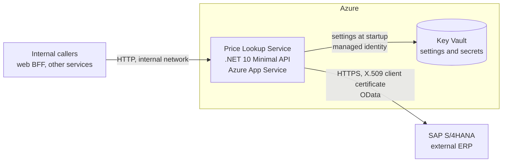

# Assumptions and decisions

Nothing in this file is stated in the [assessment](InitialRequirements/IRCO%20-%20Technical%20Assessment.pdf).
These are the author's assumptions about the environment and the decisions taken before implementation.

How to read it:

- IDs (`A1`, `A2`, ...) are referenced from the plan, the code comments and the tests.
- **Source**: `Author` means the author stated it and it is final. `Proposed` means a default chosen so that work can start; the author can change it at any time. What the author has already confirmed is listed in [Decided by the author](#decided-by-the-author).
- If an implementation step has to deviate from anything here, it updates this file and says so in its report.

## The system in one picture



## Context and deployment

| ID | Source | Assumption / decision |
|---|---|---|
| A1 | Author | We build a **small internal microservice**. It serves product SKU prices to the rest of the system (the web BFF, other services) over **internal HTTP**. |
| A2 | Author | It is deployed to **Azure App Service**. Proposed details: Linux, .NET 10, one region. |
| A3 | Proposed | **Inbound traffic is plain HTTP inside the internal network** in every environment: no HTTPS redirection, no HSTS, no inbound authentication. Network isolation (VNet integration / private endpoint) is the control. Inbound auth (Entra ID) is a possible next step. |
| A4 | Proposed | The service is **stateless**: no database, no cache (A19). Scale-out is free. |

## ERP (SAP)

| ID | Source | Assumption / decision |
|---|---|---|
| A5 | Author | The price comes from an **external ERP**, presumably **SAP S/4HANA**. It is not part of our application and lives in an external network. We only read from it. |
| A6 | Author | The connection is **HTTPS**. Proposed: TLS 1.2 is the minimum (1.2 and 1.3 enabled, everything older disabled). |
| A7 | Author | Authentication is an **X.509 client certificate** (mutual TLS). It is the only authentication mode: no Basic, no API key. |
| A8 | Author | **Development exception:** the stub (A34) speaks plain HTTP and cannot verify certificates, so in the `Development` environment `Sap:BaseUrl` may be `http` and the client certificate is optional. A certificate that is configured must load (and have a private key) in every environment, `Development` included; a broken value stops the service instead of being ignored. In every other environment the URL must be `https` and the certificate is required; the service refuses to start otherwise (A24). There is no switch that turns authentication off. |
| A9 | Proposed | **SAP contract (hypothetical, to be agreed with the SAP team):** a custom OData **V2** service exposed through ICF / SAP Gateway, see [SAP contract](#sap-contract-a9). |
| A10 | Proposed | **Price semantics:** SAP returns one current price per SKU with its currency and the last change timestamp. Pricing logic (sales organisation, customer, quantity, conditions) stays in SAP. We do not convert currencies. |
| A11 | Proposed | **SKU = SAP material number.** The input is trimmed and upper-cased; the result must match `^[A-Z0-9][A-Z0-9._-]{0,39}$` (S/4HANA material numbers have up to 40 characters). The normalised value is used for the SAP call and in the response. SAP-side conversion (for example leading zeros) is SAP's job. |
| A41 | Proposed | The **SAP server certificate** is validated with the platform's default rules. There is no option to skip validation and no custom `ServerCertificateCustomValidationCallback` (or `RemoteCertificateValidationCallback`). |

### SAP contract (A9)

Request (`Sap:BaseUrl` + `Sap:ServicePath`, `Sap:SapClient` = `100`):

```http
GET https://sap.example.invalid/sap/opu/odata/sap/ZSD_PRODUCT_PRICE_SRV/ProductPriceSet('ABC-123')?sap-client=100&$format=json
Accept: application/json
```

Success, `200 OK` (OData V2 JSON: the payload is wrapped in `d`, `Edm.Decimal` is a string, `Edm.DateTimeOffset` is `/Date(<ms since epoch>+0000)/`):

```json
{
  "d": {
    "__metadata": { "type": "ZSD_PRODUCT_PRICE_SRV.ProductPrice" },
    "Sku": "ABC-123",
    "Price": "19.99",
    "Currency": "EUR",
    "LastChangedAt": "/Date(1760868000000+0000)/"
  }
}
```

Unknown SKU, `404 Not Found` (typical SAP Gateway error body):

```json
{
  "error": {
    "code": "/IWBEP/CM_MGW_RT/020",
    "message": { "lang": "en", "value": "Resource not found for segment 'ProductPrice'" }
  }
}
```

Parsing rules: `Price` is parsed with `CultureInfo.InvariantCulture`; `LastChangedAt` accepts `/Date(ms)/` and `/Date(ms+hhmm)/` (the milliseconds are UTC, the offset is ignored). Anything that does not parse is an invalid response.

## Timeouts and retries

| ID | Source | Assumption / decision |
|---|---|---|
| A12 | Author | **Total timeout "for everything": 7000 ms**, setting `Erp:TotalTimeoutMs` in `appsettings.json`. It covers all attempts and all pauses. It only limits **our** side: when it expires we stop waiting and answer; we cannot stop SAP from finishing the (read-only, harmless) request. |
| A13 | Author | **Retries: N = 3**, setting `Erp:RetryCount`. The pause between attempts is **200 ms**, setting `Erp:RetryDelayMs`. So the total number of attempts is `1 + N = 4`. "Exactly N" means a fixed count: constant pause, no jitter, no exponential backoff, nothing adaptive. |
| A14 | Proposed | **Retried:** SAP `5xx`, `408`, `429`, network errors (`HttpRequestException`), and an attempt that hit its own timeout (A15). **Not retried:** `404` (not found), `401` / `403` (our certificate is rejected), any other `4xx`, an unparsable response. |
| A15 | Author | **Per-attempt timeout:** setting `Erp:AttemptTimeoutMs`, default **3000 ms** (the author asked for it; the value is proposed). An attempt that exceeds it is cancelled and counts as a transient failure, so it can be retried. It must not exceed `Erp:TotalTimeoutMs`. **The total timeout still wins:** "exactly N retries" holds while the 7000 ms budget allows it; if the budget expires at any moment (during an attempt or during a pause) we stop and answer `504`. |
| A16 | Proposed | **Status rule:** `504` = SAP did not answer in time: the total timeout expired, or retries ran out and the last attempt hit the attempt timeout. `502` = SAP answered with an error, or retries ran out on errors. The last attempt decides. |
| A17 | Proposed | The attempt timeout, the retries and the total timeout are **three hand-written decorator classes** around the ERP client. No Polly, no `Microsoft.Extensions.Http.Resilience`: the policy is trivial (fixed count, fixed pause) and the code is part of what the reviewers read. |
| A18 | Proposed | If the caller disconnects, the request is cancelled. This is not reported as an ERP error. |
| A19 | Proposed | **No cache.** The assessment does not ask for one and a price must be fresh. A short in-memory cache is listed as a next step. |

Examples with the default settings:

| Situation | Attempts | Approx. time | Result |
|---|---|---|---|
| SAP answers `200` | 1 | one call | `200` |
| SAP answers `503` twice, then `200` | 3 | two pauses (400 ms) + calls | `200` |
| SAP always answers `500` | 4 | three pauses (600 ms) + calls | `502 erp_unavailable` |
| SAP answers `401` | 1 | one call | `502 erp_auth_failed` |
| The first attempt hangs, the second answers `200` | 2 | 3 s + 200 ms pause + one call | `200` |
| SAP never answers | 3 (the third is cut by the total timeout) | 7 s = 3 s + 0.2 s + 3 s + 0.2 s + 0.6 s | `504 erp_timeout` |

## Errors

| ID | Source | Assumption / decision |
|---|---|---|
| A20 | Author | Every error is an RFC 9457 `ProblemDetails` (`application/problem+json`) with a machine-readable `code` extension: `400`, `404`, `502` and so on. Proposed: also a `traceId`, and `504` for the timeout. |

| Situation | HTTP | `code` |
|---|---|---|
| SKU fails validation (A11) | 400 | `invalid_sku` |
| SAP says the SKU does not exist | 404 | `sku_not_found` |
| Retries exhausted on transient errors | 502 | `erp_unavailable` |
| SAP rejects our certificate (`401` / `403`) | 502 | `erp_auth_failed` |
| SAP returns another `4xx` or a body we cannot parse | 502 | `erp_invalid_response` |
| Total timeout expired, or retries ran out and the last attempt hit the attempt timeout | 504 | `erp_timeout` |
| Unknown route | 404 | `route_not_found` |
| Wrong HTTP method | 405 | `method_not_allowed` |
| Unhandled exception | 500 | `internal_error` |
| Any other framework-generated error status | as returned | `http_error` |

## Configuration and secrets

| ID | Source | Assumption / decision |
|---|---|---|
| A21 | Author | **Locally** the settings live in `appsettings.json` (and `appsettings.Development.json`). **In Azure** they live in **Key Vault**. |
| A22 | Proposed | Key Vault is loaded at startup by the configuration provider (`AddAzureKeyVault`) with the App Service **managed identity** (`DefaultAzureCredential`). The only App Service app setting is `KeyVault__Uri` (config key `KeyVault:Uri`); the provider is skipped when it is empty. Secret names use `--` as the section separator (`Erp--RetryCount` = `Erp:RetryCount`). Key Vault values override `appsettings.json`. A change needs a restart. The repository is public: `appsettings.json` holds defaults and placeholders only, never secrets. |
| A23 | Proposed | The client certificate is stored in Key Vault as a **base64-encoded PFX** (`Sap--ClientCertificateBase64`, optional `Sap--ClientCertificatePassword`) and loaded once at startup with `X509CertificateLoader.LoadPkcs12`. Rotation = a new secret version + restart. |
| A24 | Proposed | All options are **validated at startup** (`ValidateOnStart`). The service refuses to start with invalid settings. Ranges: `TotalTimeoutMs` 1 to 60000, `AttemptTimeoutMs` 1 to 60000 and not above `TotalTimeoutMs`, `RetryCount` 0 to 10, `RetryDelayMs` 0 to 10000. SAP rules: A8. |

## Architecture and code style

| ID | Source | Assumption / decision |
|---|---|---|
| A25 | Author | **DDD style, two projects:** `Host.Api` and `Host.Core`, where "Host" is a placeholder. |
| A26 | Author | The placeholder becomes `PriceLookup`: **`PriceLookup.Api`** and **`PriceLookup.Core`**. |
| A27 | Proposed | Inside `PriceLookup.Core` the layers are folders and namespaces: **Domain** (value objects, depends on nothing), **Application** (the ERP port, the use case, the retry and timeout decorators), **Infrastructure** (the SAP adapter). Dependencies point inward: Infrastructure to Application to Domain. `PriceLookup.Api` holds HTTP endpoints, `ProblemDetails`, configuration and the composition root. The SAP adapter living in `PriceLookup.Core/Infrastructure` is confirmed by the author. A reflection-based test guards the layer rules. |
| A28 | Proposed | The domain is **deliberately thin**: this is a read-only query service. It has value objects with invariants (`Sku`, `CurrencyCode`, `Price`) and one read model (`ProductPrice`). No aggregates with behaviour, repositories or domain events: they would be decoration. |
| A29 | Author | **Small classes and small methods, no spaghetti.** Proposed measurable guide: a method up to about 15 lines, a class up to about 120 lines, one public type per file, at most two levels of nesting. |
| A30 | Author | Stack: **.NET 10, Minimal API**. |
| A31 | Author | The repository root has three folders: **`docs`** (all documents), **`src`** (the sources), **`tests`** (the tests). |
| A32 | Author | The working branch is `2026-10-20-new-vision`. (Confirmed by the author.) |
| A33 | Author | Diagrams are written in **Mermaid**. |
| A40 | Author | **Everything in the project is in English:** code, comments, documents, commit messages, and the reports and questions that agents write to the author. |

## Stub and testing

| ID | Source | Assumption / decision |
|---|---|---|
| A34 | Author | The **SAP stub** is a test project: a small separate app under `tests/` that imitates the SAP OData endpoint. Its behaviour is selected by "magic" SKUs. It is **not part of the main projects, never deployed**, and nothing in `src/` references `tests/`. |
| A35 | Proposed | Magic SKUs, see the table below. |
| A36 | Author | **One test project**, `tests/PriceLookup.Tests` (xUnit v3, folders mirror the layers), plus the stub app `tests/PriceLookup.SapStub`. Unit tests use a small programmable fake `ScriptedErpClient` and a stub `HttpMessageHandler`. Endpoint tests use `WebApplicationFactory` with the fake. End-to-end tests run the real `SapErpClient` against the stub started in-process on the loopback interface. |
| A37 | Proposed | The stub ignores credentials. X.509 against a real SAP is **not** covered by automated tests; unit tests only prove that a certificate is loaded, validated and attached to the HTTP handler. |

| SKU | Stub behaviour | Expected API result (default settings) |
|---|---|---|
| `ABC-123` | `200`, 19.99 EUR | `200` |
| `XYZ-999` | `200`, 1250.00 PLN | `200` |
| `FLAKY-1` | `503` on 2 of every 3 calls, otherwise `200`, 5.00 EUR | `200` after 3 attempts |
| `FAIL-1` | always `500` | `502 erp_unavailable` after 4 attempts |
| `AUTH-1` | `401` | `502 erp_auth_failed` after 1 attempt |
| `BROKEN-1` | `200` with malformed JSON | `502 erp_invalid_response` after 1 attempt |
| `HANG-1` | waits 10 s on every third call (calls 1, 4, 7, ...), otherwise `200`, 2.50 EUR; stops waiting when the client disconnects | `200` after 2 attempts, the first cut by the attempt timeout (about 3.2 s) |
| `SLOW-1` | always waits 10 s; stops waiting when the client disconnects | `504 erp_timeout` after about 7 s, 3 attempts |
| any other valid SKU | `404` with an SAP Gateway error body | `404 sku_not_found` |

## Frontend and BFF

| ID | Source | Assumption / decision |
|---|---|---|
| A38 | Author | The frontend and the BFF are a **separate document without code in the repo**, with illustrative scripts, on **Next.js App Router**. Proposed: the BFF is a Route Handler, a Server Action is described as the alternative; the BFF is the only public entry point; it calls the service with a timeout slightly above 7 s (8000 ms) so the service's own `504` arrives first; it does not retry (the service already does). |

## Optional work

| ID | Source | Assumption / decision |
|---|---|---|
| A39 | Author | CI and the Azure deployment are optional; they come last and only if there is time. |

## Out of scope

- Inbound authentication, rate limiting, caching, circuit breaker, OpenTelemetry / Application Insights, bulk lookups, currency conversion.
- Frontend code (the frontend is described only).
- Real calls to SAP or Azure.

## Decided by the author

- Working branch: `2026-10-20-new-vision`.
- A per-attempt timeout is required (A15). Its default value of 3000 ms is proposed.
- Everything is in English, including the agents' reports (A40).
- The SAP adapter lives in `PriceLookup.Core/Infrastructure`; `PriceLookup.Api` stays a thin HTTP shell (A27).
- Locally there is no real certificate: in `Development` the stub is reached over `http` and the certificate is optional (A8).
- Names are `PriceLookup.Api` and `PriceLookup.Core`; one test project `tests/PriceLookup.Tests` plus the stub app (A26, A36).

There are no open decisions left. If something needs to change, say so and the affected documents are updated first.

## Open questions for a real project

- Exact SAP service, entity set and field names; which price (list, sales condition, standard price); which `sap-client`.
- Certificate-to-user mapping on the SAP side and who owns certificate rotation.
- SAP response time SLA, which decides the real timeout and retry values.
- How stale a price may be, which decides whether and how long to cache.
- How a private SAP CA would be trusted, if the SAP server certificate is not issued by a public CA (A41).
