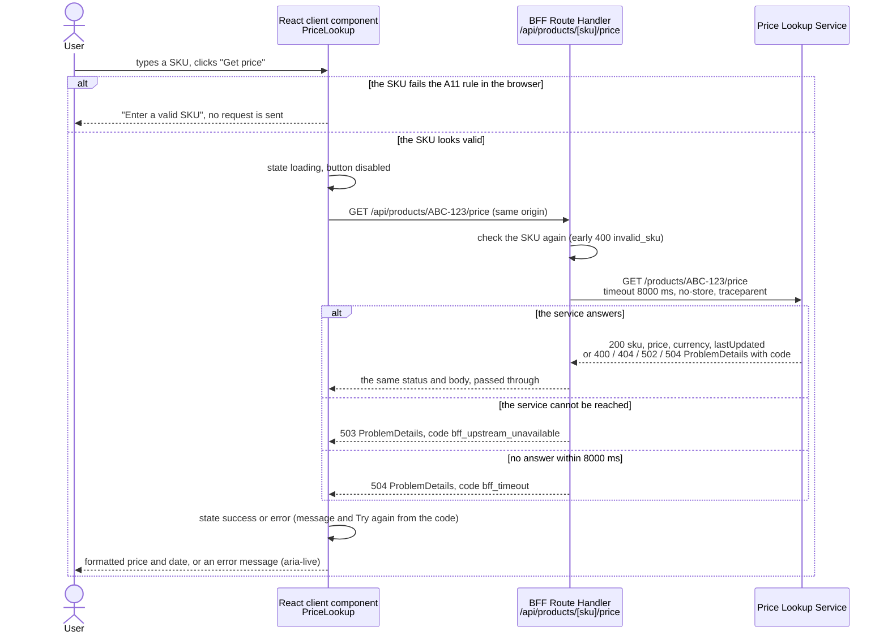

# Frontend and BFF integration

How a web frontend uses the Price Lookup Service. This document is **written only**: there is no frontend code in the repository (A38).
The four snippets are illustrative TypeScript for **Next.js 15 or later, App Router**.

| Requirement | Answer | Section |
|---|---|---|
| R9 - the frontend: SKU input, price display, loading and error states | A React hook with the states `idle`, `loading`, `success`, `error`, and a component that draws them | [3. The hook](#3-the-hook-r9), [4. The component](#4-the-component-r9) |
| R10 - the middleware: a BFF route or a server action | A Route Handler is the BFF; a Server Action is the alternative | [1. The BFF](#1-the-bff-r10), [2. Server Action alternative](#2-server-action-alternative) |
| R11 - how they call the endpoint, what the UI handles, how errors map | The request flow and one table from `code` to UI message | [Request flow](#request-flow), [Error mapping](#error-mapping-r11) |

## Overview

- The browser talks only to the Next.js app (same origin). The **BFF is the only public entry point**; the Price Lookup Service stays on the internal network (A3, A38).
- The BFF checks the SKU, calls `GET /products/{sku}/price` on the service with an 8000 ms timeout and passes the service's status and body through unchanged.
- Every error the UI sees is a `ProblemDetails` with a `code`: the service's codes (A20) plus the BFF's own `bff_upstream_unavailable` and `bff_timeout`. The UI picks its message and the "Try again" button from the `code` only.
- The BFF **does not retry**: the service already makes up to 4 attempts within 7 s (A12, A13).

```text
app/
  page.tsx                               renders <PriceLookup />
  api/products/[sku]/price/route.ts      snippet 1: the BFF route
  actions/get-price.ts                   snippet 2: the Server Action alternative
lib/
  price-service.ts                       snippet 1: server only, the one call to the service
components/
  usePriceLookup.ts                      snippet 3: the hook (states, fetch, error texts)
  PriceLookup.tsx                        snippet 4: the component (input, result)
```

A real answer from the service, running against the SAP stub (a `ProblemDetails` example is in [architecture.md, Errors](architecture.md#errors)):

```http
HTTP/1.1 200 OK
Content-Type: application/json; charset=utf-8

{"sku":"ABC-123","price":19.99,"currency":"EUR","lastUpdated":"2025-10-19T10:00:00+00:00"}
```

## Request flow



## 1. The BFF (R10)

`lookUpPrice` is the only code that talks to the Price Lookup Service. It runs on the server only, so the internal address never reaches the browser, and it always returns an HTTP response: the service's own answer, or a `ProblemDetails` of the BFF when the SKU is invalid, the service cannot be reached, or it does not answer in 8000 ms.
The Route Handler is the public URL the browser calls; it just hands over to `lookUpPrice`.

```ts
// lib/price-service.ts - server only: the one place that calls the Price Lookup Service.
import 'server-only'; // the build fails if browser code imports this file

const SERVICE_URL = process.env.PRICE_SERVICE_URL; // no NEXT_PUBLIC_ prefix: never sent to the browser
const TIMEOUT_MS = 8000; // above the service's 7000 ms total, so its own 504 arrives first (A38)
const SKU_PATTERN = /^[A-Za-z0-9][A-Za-z0-9._-]{0,39}$/; // A11; lower case is upper-cased below

export async function lookUpPrice(rawSku: string, traceparent: string | null): Promise<Response> {
  const trimmed = rawSku.trim();
  // Check first, upper-case after: JavaScript turns "ß" into "SS", .NET does not.
  if (!SKU_PATTERN.test(trimmed)) return problem(400, 'invalid_sku', 'Invalid SKU');
  const sku = trimmed.toUpperCase();

  try {
    const upstream = await fetch(`${SERVICE_URL}/products/${encodeURIComponent(sku)}/price`, {
      headers: traceparent ? { traceparent } : {}, // one trace id in the BFF and service logs
      cache: 'no-store', // a price must be fresh (A19)
      signal: AbortSignal.timeout(TIMEOUT_MS), // no retries here: the service already retries (A13)
    });
    // Pass the answer through: 200 with the price, or the service's ProblemDetails with a code.
    const body = await upstream.text(); // read inside the try, so the timeout covers it too
    const contentType = upstream.headers.get('content-type') ?? 'application/json';
    return new Response(body, { status: upstream.status, headers: { 'content-type': contentType } });
  } catch (error) {
    console.error('Price service call failed', error); // details, including the URL, stay in the server log
    return error instanceof DOMException && error.name === 'TimeoutError'
      ? problem(504, 'bff_timeout', 'Price lookup timed out')
      : problem(503, 'bff_upstream_unavailable', 'Price service unavailable');
  }
}

// The BFF's own errors have the service's ProblemDetails shape, without internal details.
function problem(status: number, code: string, title: string): Response {
  return Response.json({ status, title, code }, { status, headers: { 'content-type': 'application/problem+json' } });
}

// app/api/products/[sku]/price/route.ts - the BFF route, the only public way to the price service.
import { lookUpPrice } from '@/lib/price-service';

// Next.js 15 and later: params is a Promise.
export async function GET(request: Request, { params }: { params: Promise<{ sku: string }> }) {
  return lookUpPrice((await params).sku, request.headers.get('traceparent'));
}
```

Only `content-type` is copied from the service's answer, and the BFF's own error bodies contain neither the internal URL nor the original error message. The service's `instance` field is a path (`GET /products/ABC-123/price`), never a host name.

## 2. Server Action alternative

The same lookup offered as a Server Action: a function the React code calls directly, without a URL of our own. It reuses `lookUpPrice` from snippet 1 and turns its HTTP response into a plain object, `{ ok: true, data } | { ok: false, code, message }`.

```ts
// app/actions/get-price.ts - the alternative to the Route Handler.
'use server';
import { headers } from 'next/headers';
import { lookUpPrice } from '@/lib/price-service';

type Price = { sku: string; price: number; currency: string; lastUpdated: string };
export type PriceResult = { ok: true; data: Price } | { ok: false; code: string; message: string };

export async function getPrice(sku: string): Promise<PriceResult> {
  const traceparent = (await headers()).get('traceparent'); // Next.js 15 and later: headers() is async
  const response = await lookUpPrice(sku, traceparent); // validates the SKU too: an action is public
  const body = await response.json().catch(() => ({})); // a body that is not JSON
  return response.ok
    ? { ok: true, data: body }
    : { ok: false, code: body.code ?? 'unknown', message: body.title ?? 'Unknown error' };
}
```

To use it, the hook (snippet 3) calls `getPrice(sku)` instead of `fetch` and reads `result.ok`, `result.data` and `result.code`; the UI text still comes from the `code`.

| | Route Handler (chosen) | Server Action |
|---|---|---|
| Shape | A real HTTP `GET` with real status codes, visible in devtools and access logs | A function call; always `POST`; errors live only in the returned object |
| Cancel a stale request | Yes, `AbortController` | No, a late answer can only be ignored |
| Other callers (mobile app, other teams) | Yes | Only this Next.js app |

Choose the Server Action when the lookup is one field of a larger form in this app and nothing else will call it. Otherwise use the Route Handler: Next.js describes Server Actions as meant for mutations and currently sends them one at a time per client, which does not suit a read the user may repeat quickly.

## 3. The hook (R9)

`usePriceLookup` holds everything the screen needs to know: the state (`idle`, `loading`, `success`, `error`), the call to the BFF, and the UI message and "Try again" decision for each `code`. Keeping this logic out of the component means the component only draws, and the error rules live in one place.

```ts
// components/usePriceLookup.ts - lookup state, the call to the BFF, and the error texts.
import { useEffect, useRef, useState } from 'react';

type Price = { sku: string; price: number; currency: string; lastUpdated: string };
export type LookupState =
  | { status: 'idle' } | { status: 'loading' } | { status: 'success'; data: Price }
  | { status: 'error'; message: string; canRetry: boolean };

const UNAVAILABLE = 'Prices are unavailable right now. Please try again in a moment.';
const BROKEN = 'Prices are unavailable right now. We are working on it.';
const TOO_SLOW = 'The price lookup took too long. Please try again.';
const MESSAGES: Record<string, string> = {
  invalid_sku: 'Enter a valid SKU: up to 40 letters, digits, ".", "_" or "-".',
  sku_not_found: 'There is no product with this SKU.',
  erp_auth_failed: BROKEN, erp_invalid_response: BROKEN,
  erp_unavailable: UNAVAILABLE, bff_upstream_unavailable: UNAVAILABLE,
  erp_timeout: TOO_SLOW, bff_timeout: TOO_SLOW,
}; // any other code: "Something went wrong on our side."
// "Try again" only where the service itself would retry (A14), or where time or reachability failed.
const NO_RETRY = ['invalid_sku', 'sku_not_found', 'route_not_found', 'method_not_allowed',
  'erp_auth_failed', 'erp_invalid_response'];
const error = (code = 'unknown'): LookupState => ({ status: 'error',
  message: MESSAGES[code] ?? 'Something went wrong on our side.', canRetry: !NO_RETRY.includes(code) });

export function usePriceLookup() {
  const [state, setState] = useState<LookupState>({ status: 'idle' });
  const pending = useRef<AbortController | null>(null);
  useEffect(() => () => pending.current?.abort(), []); // cancel when the component goes away

  async function lookUp(input: string) {
    const sku = input.trim(); // the A11 check below is a UX hint; the BFF and the service check again
    if (!/^[A-Za-z0-9][A-Za-z0-9._-]{0,39}$/.test(sku)) return setState(error('invalid_sku'));
    const controller = (pending.current = new AbortController());
    setState({ status: 'loading' });
    try {
      const response = await fetch(`/api/products/${encodeURIComponent(sku)}/price`, { signal: controller.signal });
      const body = await response.json();
      setState(response.ok ? { status: 'success', data: body } : error(body.code));
    } catch { // offline, or a body that is not JSON; a cancelled request is ignored on purpose
      if (!controller.signal.aborted) setState(error());
    }
  }
  function cancel() { // called when the SKU is edited: the old SKU's answer is no longer wanted
    pending.current?.abort();
    setState((current) => (current.status === 'loading' ? { status: 'idle' } : current));
  }

  return { state, lookUp, cancel };
}
```

## 4. The component (R9)

`PriceLookup` is what the user sees: the SKU input, the button and the result. It draws the state from the hook and formats the price and the date in the user's own locale, with the currency the service returned.

```tsx
// components/PriceLookup.tsx - SKU input, submit button and the result. Rendered by app/page.tsx.
'use client';
import { useState } from 'react';
import { usePriceLookup } from './usePriceLookup';

// undefined = the browser's locale. Runs only after a lookup in the browser, so no hydration mismatch.
const formatPrice = (price: number, currency: string) =>
  new Intl.NumberFormat(undefined, { style: 'currency', currency }).format(price);
const formatDate = (iso: string) =>
  new Intl.DateTimeFormat(undefined, { dateStyle: 'medium', timeStyle: 'short' }).format(new Date(iso));

export function PriceLookup() {
  const [sku, setSku] = useState('');
  const { state, lookUp, cancel } = usePriceLookup();
  const loading = state.status === 'loading';

  return (
    <form onSubmit={(event) => { event.preventDefault(); lookUp(sku); }}>
      <label htmlFor="sku">SKU</label>
      <input id="sku" value={sku} onChange={(event) => { setSku(event.target.value); cancel(); }} />
      <button type="submit" disabled={loading}>{loading ? 'Looking up...' : 'Get price'}</button>

      {/* Screen readers announce whatever appears in this region. */}
      <div aria-live="polite">
        {loading && <p>Looking up the price...</p>}
        {state.status === 'success' && (
          <p>
            SKU {state.data.sku}: <strong>{formatPrice(state.data.price, state.data.currency)}</strong>
            <br />
            Last updated <time dateTime={state.data.lastUpdated}>{formatDate(state.data.lastUpdated)}</time>
          </p>
        )}
        {state.status === 'error' && <p>{state.message}</p>}
        {state.status === 'error' && state.canRetry && (
          <button type="button" onClick={() => lookUp(sku)}>Try again</button>
        )}
      </div>
    </form>
  );
}
```

- **loading:** the button is disabled, so the same lookup cannot be sent twice. Editing the SKU cancels the request in flight (`AbortController`) and goes back to idle.
- **success:** for example `€19.99` and `Oct 19, 2025, 12:00 PM` in `en-US` (Warsaw time), `19,99 €` in `de-DE`, `1250,00 zł` for `XYZ-999` in `pl-PL`.
- **error:** the message for the `code`, and the "Try again" button where the table below says so.

## Error mapping (R11)

The UI decides from the `code` alone and never shows the service's `detail` text. **"Try again" is offered only where the service itself would retry (A14), or where the failure is about time or reachability.** It is hidden for a bad or unknown SKU, for BFF bugs, and for SAP rejecting our certificate or sending an unreadable answer, because pressing it again cannot help.

| `code` | HTTP | Set by | Situation | UI message | Try again |
|---|---|---|---|---|---|
| `invalid_sku` | 400 | browser, BFF or service | the SKU fails the A11 rule | Enter a valid SKU: up to 40 letters, digits, ".", "_" or "-". | No |
| `sku_not_found` | 404 | service | SAP has no product with this SKU | There is no product with this SKU. | No |
| `route_not_found` | 404 | service | the BFF called a wrong path (a BFF bug) | Something went wrong on our side. | No |
| `method_not_allowed` | 405 | service | the BFF used a wrong method (a BFF bug) | Something went wrong on our side. | No |
| `erp_auth_failed` | 502 | service | SAP rejected the service's certificate | Prices are unavailable right now. We are working on it. | No |
| `erp_invalid_response` | 502 | service | SAP answered with something unreadable | Prices are unavailable right now. We are working on it. | No |
| `erp_unavailable` | 502 | service | SAP kept failing, retries exhausted | Prices are unavailable right now. Please try again in a moment. | Yes |
| `erp_timeout` | 504 | service | SAP did not answer within the service's 7 s | The price lookup took too long. Please try again. | Yes |
| `internal_error` | 500 | service | an unhandled exception in the service | Something went wrong on our side. | Yes |
| `http_error` | as returned | service | any other framework-generated error | Something went wrong on our side. | Yes |
| `bff_upstream_unavailable` | 503 | BFF | the service cannot be reached (connection refused, DNS) | Prices are unavailable right now. Please try again in a moment. | Yes |
| `bff_timeout` | 504 | BFF | no answer from the service within 8000 ms | The price lookup took too long. Please try again. | Yes |
| anything else | - | browser | an unknown code, a body that is not JSON, the browser is offline | Something went wrong on our side. | Yes |

## Notes

- **No retries in the BFF.** The service already retries up to 3 times within 7 s (A12, A13); BFF retries would multiply the load on SAP. The only extra retry is the user's own "Try again".
- **The timeouts nest:** attempt 3000 ms < service total 7000 ms < BFF 8000 ms, so the user normally sees the service's precise `504 erp_timeout`, and `bff_timeout` only when the service itself does not answer.
- **The BFF is the only public entry point.** The service has no inbound authentication and relies on the internal network (A3); the browser knows nothing but `/api/products/{sku}/price`.
- **Client-side validation is a UX hint.** It saves a round trip for an obvious typo. The BFF checks again, because anyone can call `/api/...` directly, and the service (`Sku.TryParse`) stays the authority.
- **Correlation:** the BFF forwards an incoming `traceparent`, and the service reports the same trace id in its `traceId` (checked: `traceparent: 00-0af7651916cd43dd8448eb211c80319c-b7ad6b7169203331-01` came back as `"traceId":"00-0af7651916cd43dd8448eb211c80319c-fd8a6e69c3f8bb6f-01"`). Browsers do not send `traceparent` themselves; it comes from tracing (OpenTelemetry) in front of the BFF or in Next.js.
- **Cancellation:** a cancelled browser request is ignored by the UI; the BFF's call to the service still finishes or times out, which is harmless for a read (A18).
